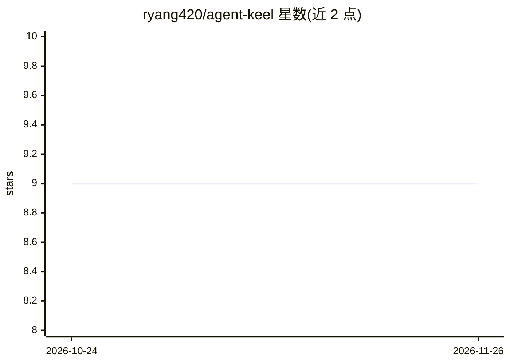

# ryang420/agent-keel

⭐ 9 · Python · MIT · 推送 2026-11-19 · [GitHub](https://github.com/ryang420/agent-keel) · 个人维护 · 中文 README

**服务端多租户 agent 运行时：HTTP+SSE 跑模型工具循环**

一个服务端 agent 运行时：通过 HTTP 接收消息，在 Docker 沙箱内执行模型与工具循环，以 SSE 流式返回结果。定位为后端服务而非 CLI 或聊天界面，供开发者接入自己的产品，每个用户 profile 拥有独立沙箱、会话与技能。运行以 Postgres 队列承载持久化 runs，事件可重放续接；内置 Bedrock Mantle 与 OpenAI 兼容 Responses 端点两类 provider。当前为 Pre-1.0（0.4.0），API 与数据库结构可能在版本间变更，需 Postgres 并在升级前备份。

## 筛选速览

| 维度 | 判定 | 备注 |
|---|---|---|
| AI 角色 | `ai-ecosystem` | LLM/agent 周边工具 |
| 许可风险 | `permissive` | MIT |
| 部署形态 | `self-host` | docker 或自建部署 |
| 模型依赖 | locked-api |  |
| 硬件要求 | — | 无带数字的原话,不猜 |
| 安装摩擦 | `low` | 无编译、无系统依赖或容器化 |
| 成熟度 | `idea` | |

## 能力要点

- 单套 HTTP+SSE API：创建 profile、启动 run、跟随事件、停止、读取会话历史
- runs 持久化为 Postgres 队列，事件可断线重放
- 每 profile 独立加固 Docker 沙箱，支持 runsc/kata 运行时与资源限制
- 内置 8 个工具与 SKILL.md 技能目录机制

## 适用场景

- 为自有产品提供后端 agent 执行服务，多用户各自隔离沙箱
- 需要断线重连与事件重放的长时间 agent 运行
- 按 profile 策略控制工具的容器隔离执行

## 场景标签

`Agent 框架` · 领域:Agent 开发

## 证据(README 行号)

> L5: A server-side, multi-tenant agent runtime. You send it a message over HTTP; it runs a model-and-tools loop in a
> L8: It is **not** a command-line coding agent and **not** a chat UI. It is the service you put behind your own

## 星数曲线

2026-10-24 9 → 2026-11-26 9（+0）

---
*卡片 v1 · prompt 1.4 · 生成 2026-11-20 · 置信度 high · 依据 README sha `03c61825be59` · [字段定义](../../DATASET.md)*
