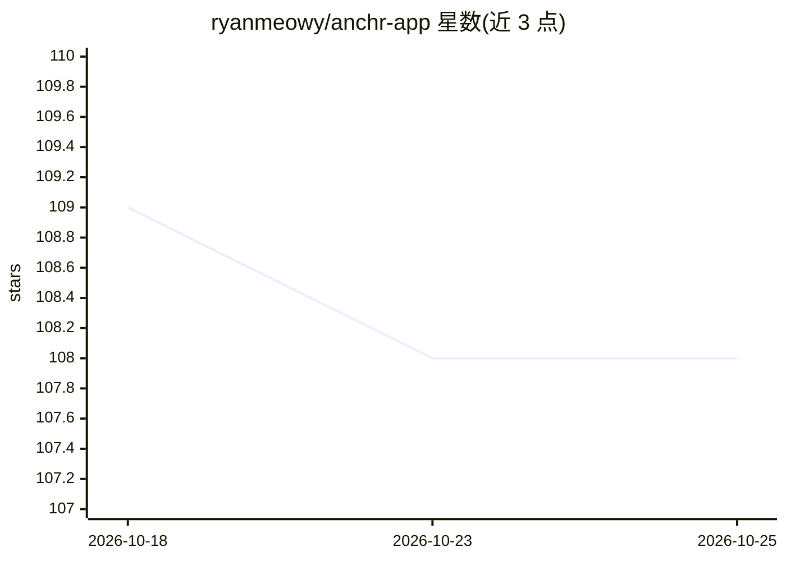

# ryanmeowy/anchr-app

⭐ 108 · Java · MIT · 推送 2026-10-20 · [GitHub](https://github.com/ryanmeowy/anchr-app) · [官网](https://anchr.cloud) · 个人维护 · 中文 README

**自托管文档知识库/RAG 后端：混合检索、带引用回答与 Agent 深读**

面向需要在自有文档中检索、提问与研究的知识工作者的自托管文档知识工作区后端（Anchr App，API 服务）：将文档导入知识库后提供词法+语义混合检索、带引用与结果卡片的有据回答、引用片段原文预览核验，以及可发现/检索/顺序阅读/摘要文档的 Agent 多步深读（含运行状态、恢复与取消）。完整产品还需 Anchr Web 与 Anchr Docling 及自配存储与模型服务；当前为单实例单租户部署，不支持水平多副本。

## 筛选速览

| 维度 | 判定 | 备注 |
|---|---|---|
| AI 角色 | `ai-native` | 本体是模型或模型工具 |
| 许可风险 | `permissive` | MIT |
| 部署形态 | `None` |  |
| 模型依赖 | — | README 未给出锁定关系 |
| 硬件要求 | — | 无带数字的原话,不猜 |
| 安装摩擦 | `low` | 无编译、无系统依赖或容器化 |
| 成熟度 | — | 结构信号不足 |

## 能力要点

- 词法+语义混合检索，可按知识库/文档/元数据限定范围
- 回答附引用与文档级结果卡片，可打开引用片段及上下文核验
- Agent 在授权范围内多步发现、检索、顺序阅读与摘要文档，运行状态可查、可恢复/取消
- 生成、嵌入、重排与存储后端可自选，提供 API 集成

## 适用场景

- 在内部制度与手册中找到条款并获得可核验的带引用解释
- 跨多份报告做研究综述并保留每个结论的来源
- 把文档检索、有据问答能力通过 API 接入现有门户或内部应用
- 在选定的长文档内提问、顺序阅读或发起摘要任务

## 场景标签

`RAG` `文档问答` · 领域:知识与检索

## 证据(README 行号)

> L25: Anchr is an open-source, self-hostable document knowledge workspace for people who need to search, question, study,
> L131: |**Grounded answers**|Generate answers from retrieved evidence with citations, result cards, and suggested follow-

## 星数曲线

2026-10-18 109 → 2026-10-25 108（-1）

---
*卡片 v1 · prompt 1.4 · 生成 2026-10-23 · 置信度 high · 依据 README sha `501d568bb330` · [字段定义](../../DATASET.md)*
