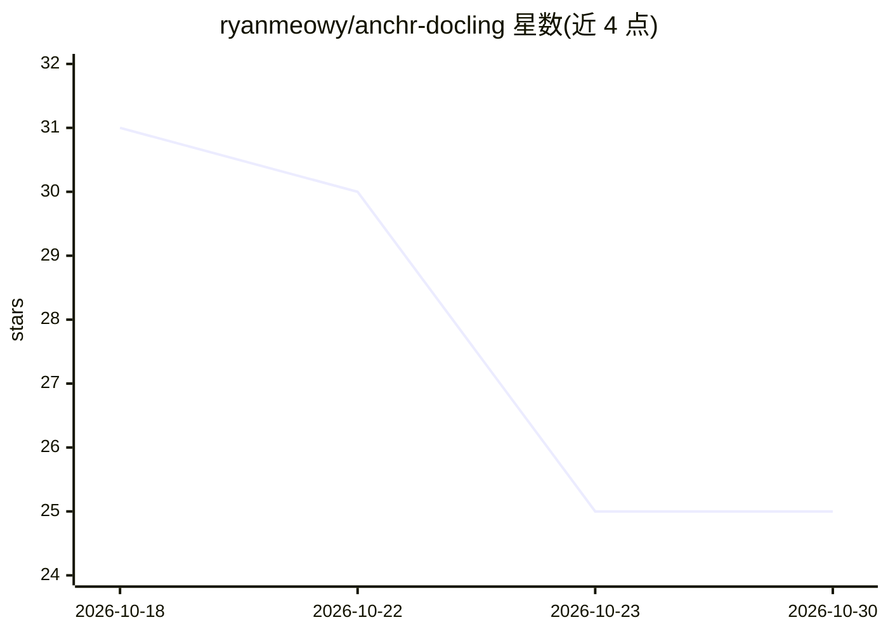

# ryanmeowy/anchr-docling

⭐ 25 · Python · MIT · 推送 2026-10-15 · [GitHub](https://github.com/ryanmeowy/anchr-docling) · 个人维护 · 中文 README

**面向 Anchr App 的异步 Docling 文档解析 sidecar 服务**

基于 FastAPI 的自托管文档解析服务：Anchr App 提交带签名的 HTTPS 下载 URL，服务经有界内存队列运行 Docling，返回 Markdown、纯文本、结构化 JSON、blocks 或 chunks 等多种输出格式，支持 OCR、表格结构识别与公式增强，并可把内嵌图片上传到指定阿里云 OSS 目录。服务自身不持久化任务与文档：任务状态与幂等记录仅存于进程内存，结果默认保留 10 分钟。源文件下载受 HTTPS 主机白名单限制，需配置至少 32 字符的内部 Bearer Token。设备可选 cpu/mps/cuda/xpu/auto。

## 筛选速览

| 维度 | 判定 | 备注 |
|---|---|---|
| AI 角色 | `ai-native` | 本体是模型或模型工具 |
| 许可风险 | `permissive` | MIT |
| 部署形态 | `library` | 以包/库形式分发 |
| 模型依赖 | — | README 未给出锁定关系 |
| 硬件要求 | — | 无带数字的原话,不猜 |
| 安装摩擦 | `medium` | 含编译或系统依赖之一 |
| 成熟度 | — | 结构信号不足 |

## 能力要点

- 异步任务 API：POST/GET/DELETE /v1/jobs，requestId 幂等键（v2/v3 指纹排除会过期的签名 URL）
- 输出格式覆盖 markdown/html/text/json/blocks/chunks，chunk 参数可调（自研与 Docling HybridChunker 两种）
- OCR 直开与乱码回退（ocrFallback），文本质量校验判定失败
- 内嵌图片经 AES-GCM 加密 STS 凭证上传至白名单约束的 OSS 目标

## 适用场景

- 为 RAG 知识库入库流程提供文档到 Markdown/chunks 的解析服务
- 作为 Anchr App 的独立文档解析组件自托管部署
- 对图片型输入开启 OCR 提取文本

## 场景标签

`文档解析` · 领域:知识与检索

## 证据(README 行号)

> L10: Anchr Docling provides document parsing for Anchr App. The app submits a signed HTTPS download URL, and the service
> L122: |`outputFormat`|`markdown`|`markdown`, `html`, `text`, `json`, `blocks`, or `chunks`.|
> L164: |PDF|All formats|Supports tables, OCR, formula enrichment, and page-level results.|

## 星数曲线

2026-10-18 31 → 2026-10-30 25（-6）

---
*卡片 v1 · prompt 1.4 · 生成 2026-10-26 · 置信度 mid · 依据 README sha `d38673e26d87` · [字段定义](../../DATASET.md)*
