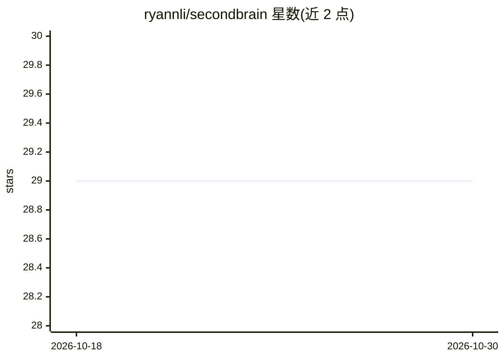

# ryannli/secondbrain

⭐ 29 · TypeScript · MIT · 推送 2026-07-04 · [GitHub](https://github.com/ryannli/secondbrain) · 个人维护

**本地优先的个人知识库，内置 agent 帮知识工作者筛选与管理阅读**

面向知识工作者的本地优先个人信息工作区：捕获链接、文本、PDF、图片（含 Chrome 扩展一键抓取登录态页面），由内置 agent 对每次捕获打分与批判、提取概念、与库内已有资料对照并标出矛盾；提供基于 RSS 与可选 Brave 搜索的 For You 推荐流。核心分析通过本地已登录的 agent CLI（Claude Code 或 OpenAI Codex）子进程运行，无需单独模型 API key，Agent Mode 为必需（未连接则出现设置门槛）。数据以普通文件夹形式本地存储，无托管后端。

## 筛选速览

| 维度 | 判定 | 备注 |
|---|---|---|
| AI 角色 | `ai-native` | 本体是模型或模型工具 |
| 许可风险 | `permissive` | MIT |
| 部署形态 | `library` | 以包/库形式分发 |
| 模型依赖 | locked-api |  |
| 硬件要求 | — | 无带数字的原话,不猜 |
| 安装摩擦 | `low` | 无编译、无系统依赖或容器化 |
| 成熟度 | — | 结构信号不足 |

## 能力要点

- 捕获内容经 agent 打分、批判与库内矛盾对照，所有结论可编辑
- 通过本地 agent CLI（Claude Code / OpenAI Codex）运行分析，无需单独模型 API key
- For You 流基于 RSS 与可选 Brave 搜索，按库内阅读历史排序，无 key 也可用
- 数据本地文件夹存储（USER.md / MEMORY.md 可见可编辑），无云端后端

## 适用场景

- 捕获网页、PDF、推文并让 agent 帮我判断是否值得读
- 把阅读资料组织成个人知识库并跨资料发现矛盾与联系
- 每天获得基于自己库的个性化信息简报

## 场景标签

`知识库管理` `AI 助手` · 领域:对话与助手

## 证据(README 行号)

> L31: Second Brain is a local-first **personal knowledge base** with an agent inside. It helps you judge what matters, di
> L39: - **Capture anything in seconds** — paste a link or text, drop a PDF or image, or one-click the Chrome extension (l
> L145: Second Brain calls a local agent CLI via subprocess — Claude Code (`claude`) or OpenAI Codex (`codex`). Pick your 

## 星数曲线

2026-10-18 29 → 2026-10-30 29（+0）

---
*卡片 v1 · prompt 1.4 · 生成 2026-10-26 · 置信度 high · 依据 README sha `9685a71ed998` · [字段定义](../../DATASET.md)*
