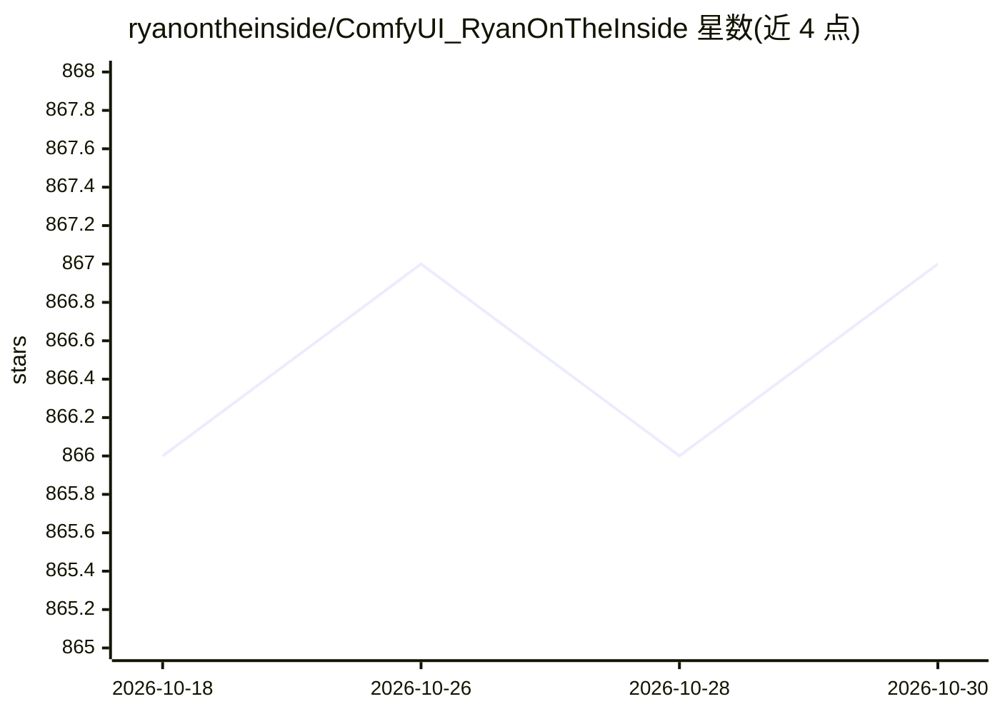

# ryanontheinside/ComfyUI_RyanOnTheInside

⭐ 867 · Python · MIT · 推送 2026-03-20 · [GitHub](https://github.com/ryanontheinside/ComfyUI_RyanOnTheInside) · 个人维护

**ComfyUI 反应性节点包：用音频/MIDI/运动等驱动图像与视频创作**

面向 ComfyUI 用户的节点扩展包：从音频（幅度、频谱、Onset、Chroma）、MIDI（力度、音高、CC）、运动、深度、颜色、亮度、时间及 Whisper 转录文本中提取特征，用这些特征调制 Flex 节点的参数，控制 IPAdapter、遮罩、图像、视频与粒子系统；含音轨分离、光流遮罩生成，并提供 ACE-Step 1.5 音乐生成模型的原生 ComfyUI guider（扩展/重绘、Cover）。与 Depthflow、AdvancedLivePortrait、AnimateDiff-Evolved、AdvancedControlnet 等节点包集成。V2 改为 MIT 许可。

## 筛选速览

| 维度 | 判定 | 备注 |
|---|---|---|
| AI 角色 | `ai-ecosystem` | LLM/agent 周边工具 |
| 许可风险 | `permissive` | MIT |
| 部署形态 | `library` | 以包/库形式分发 |
| 模型依赖 | — | README 未给出锁定关系 |
| 硬件要求 | — | 无带数字的原话,不猜 |
| 安装摩擦 | `low` | 无编译、无系统依赖或容器化 |
| 成熟度 | — | 结构信号不足 |

## 能力要点

- 从音频/MIDI/运动/深度/颜色/亮度/时间提取特征并调制节点参数
- ACE-Step 1.5 原生 guider：扩展/重绘与 Cover 风格迁移
- 集成 OpenAI Whisper 将语音转录文本作为特征源（含触发系统）
- 粒子系统（力场、边界、弹簧关节）与光流运动遮罩

## 适用场景

- 在 ComfyUI 中制作音频反应式图像与视频动画
- 用 MIDI 控制器实时驱动视觉参数
- 对音乐做音轨分离后分轨驱动不同效果
- 用 ACE-Step 1.5 扩展或重绘生成音乐片段

## 场景标签

`图像生成` `视频生成` · 领域:内容生成

## 证据(README 行号)

> L7: ### These nodes react to **everything**, including audio.
> L11: **Everything Reactivity**: Almost all nodes in this pack can be made to react to audio, MIDI, motion, time, color, 
> L106: Native ComfyUI guiders for the new ACE-Step 1.5 music generation model.

## 星数曲线

2026-10-18 866 → 2026-10-30 867（+1）

---
*卡片 v1 · prompt 1.4 · 生成 2026-10-21 · 置信度 mid · 依据 README sha `a0603c7fb1ae` · [字段定义](../../DATASET.md)*
