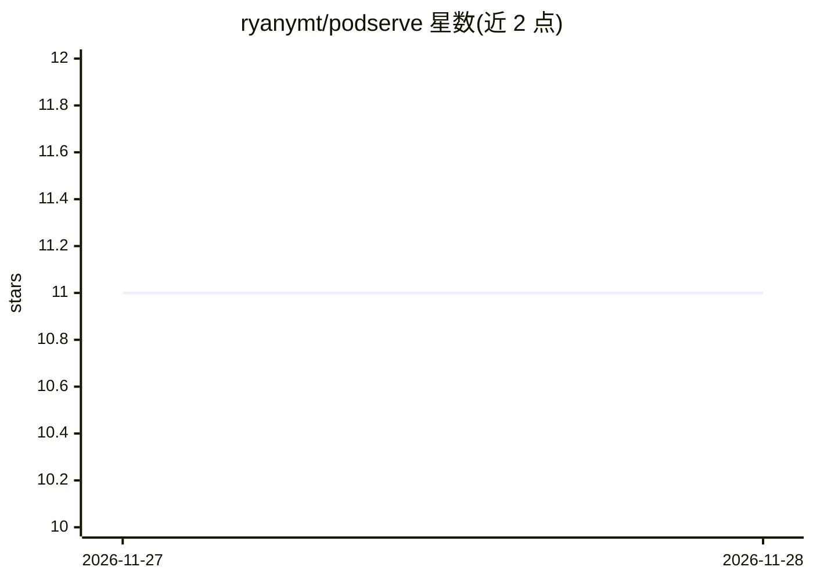

# ryanymt/podserve

⭐ 11 · Go · Apache-2.0 · 推送 2026-11-20 · [GitHub](https://github.com/ryanymt/podserve) · 个人维护

**一条命令在 GKE 上用 vLLM 部署 Hugging Face 模型的工具**

podserve 是一个开源部署工具，面向需要在自有 GCP 项目中部署 Hugging Face 模型的开发者。用户执行 podserve plan 即可读取模型的 config.json，校验 vLLM 架构支持并计算 GPU 数量、张量并行度与上下文长度；deploy 则通过 Terraform 预置的 GKE Autopilot 平台缓存权重到 GCS、调度 spot NVIDIA L4 节点，并暴露 OpenAI 兼容 /v1 API，附带 Cloud Monitoring 监控面板。当前限制：仅支持 text-generation 模型与 .safetensors 权重，单副本、ClusterIP 内部访问，外部 ingress 与自动扩缩容在后续版本路线图上。

## 筛选速览

| 维度 | 判定 | 备注 |
|---|---|---|
| AI 角色 | `ai-ecosystem` | LLM/agent 周边工具 |
| 许可风险 | `permissive` | Apache-2.0 |
| 部署形态 | `library` | 以包/库形式分发 |
| 模型依赖 | local-ok | 支持本地模型 |
| 硬件要求 | — | 无带数字的原话,不猜 |
| 安装摩擦 | `low` | 无编译、无系统依赖或容器化 |
| 成熟度 | `idea` | |

## 能力要点

- 零 GPU 预检（podserve plan）：计算 GPU 数量、张量并行度、KV cache 容量
- 一条命令端到端部署，OpenAI 兼容 /v1 API
- 权重按 commit SHA 缓存到 GCS，vLLM 离线流式读取
- Cloud Monitoring 面板含 TTFT、吞吐、KV cache 等指标

## 适用场景

- 在自己的 GCP 项目中一条命令部署 Hugging Face 模型推理服务
- 部署前预估某模型需要的 GPU 数量与配置
- 需要 OpenAI 兼容接口的本地推理端点

## 场景标签

`推理引擎` · 领域:训练与推理

## 证据(README 行号)

> L3: **podserve** is an open-source stack for deploying and serving Hugging Face models on Google Kubernetes Engine (GKE)
> L5: Point podserve at a model on the Hugging Face Hub and it computes the hardware sizing and engine settings before any
> L20: - **Zero-GPU planner (`podserve plan`):** fetches `config.json` from Hugging Face, validates vLLM `v0.32.0` archite

## 星数曲线

2026-11-27 11 → 2026-11-28 11（+0）

---
*卡片 v1 · prompt 1.4 · 生成 2026-11-27 · 置信度 high · 依据 README sha `ad87b864d1d7` · [字段定义](../../DATASET.md)*
