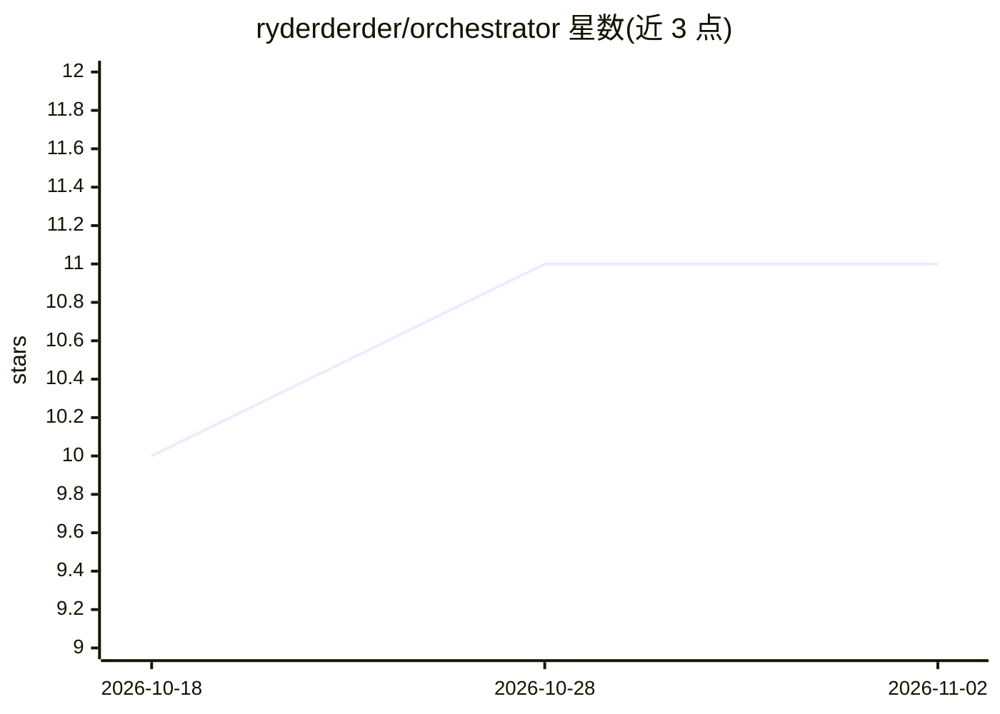

# ryderderder/orchestrator

⭐ 11 · Python · MIT · 推送 2026-08-09 · [GitHub](https://github.com/ryderderder/orchestrator) · 个人维护

**把多个 AI 订阅 CLI 编成 tmux 团队并按配额路由**

单文件 Python 工具（仅依赖标准库与 tmux），将 Claude Code、Codex、Grok、Gemini、Antigravity 等官方 CLI 以带标签的 tmux 面板组织为团队：左 pane 为 lead agent，任务按各订阅剩余配额路由到相应 provider；支持交互式 spawn 与 headless dispatch（结果以 JSON 返回）、后续追问恢复同一 provider 会话、每个写手独立 git worktree 隔离并行修改并由 `orchestrator land` 合并。也可通过 [providers.custom.*] 配置块接入任意 CLI。不读取、存储或传输凭据。需 macOS/Linux、tmux、Python 3.11+ 与至少一个已登录的 provider CLI。

## 筛选速览

| 维度 | 判定 | 备注 |
|---|---|---|
| AI 角色 | `ai-ecosystem` | LLM/agent 周边工具 |
| 许可风险 | `permissive` | MIT |
| 部署形态 | `None` |  |
| 模型依赖 | locked-api |  |
| 硬件要求 | — | 无带数字的原话,不猜 |
| 安装摩擦 | `low` | 无编译、无系统依赖或容器化 |
| 成熟度 | — | 结构信号不足 |

## 能力要点

- 按订阅剩余配额将任务路由到相应 provider CLI
- tmux 面板化的 lead-teammates 团队，可观察可干预
- headless dispatch 返回 JSON 结果，follow-up 恢复同一 provider 会话
- 每写手独立 git worktree，`orchestrator land` 审查后合并分支

## 适用场景

- 把一个任务分发给多个 provider 并行执行后比较结果
- builder/reviewer 工作流：一个 provider 写代码另一个审 diff
- 按各订阅剩余额度选择执行通道，继续追问保持同一会话

## 场景标签

`多智能体` `编码 Agent` · 领域:Agent 开发

## 证据(README 行号)

> L6: or Antigravity. Orchestrator turns a tmux window into one team: a lead agent
> L10: **How it works.** Every teammate is a real provider CLI in a real tmux

## 星数曲线

2026-10-18 10 → 2026-11-02 11（+1）

---
*卡片 v1 · prompt 1.4 · 生成 2026-11-01 · 置信度 high · 依据 README sha `5d29ad04c15d` · [字段定义](../../DATASET.md)*
