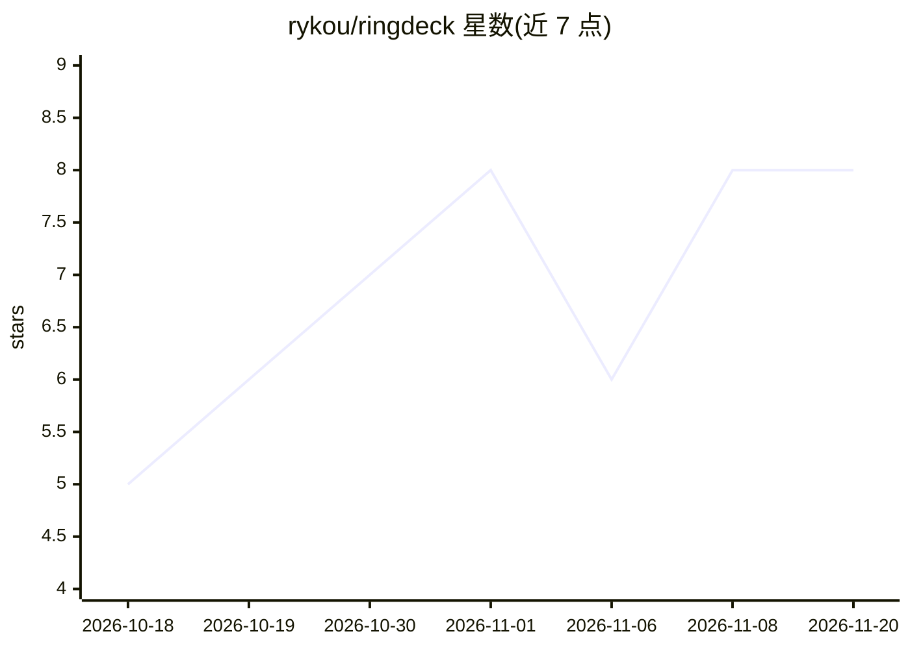

# rykou/ringdeck

⭐ 8 · C# · MIT · 推送 2026-11-04 · [GitHub](https://github.com/rykou/ringdeck) · [官网](https://apps.microsoft.com/detail/9N75XDTQ48GV) · 个人维护

**Windows 径向菜单工具：快捷键唤出环形切片执行宏、粘贴、AI 问答**

面向 Windows 桌面用户的径向菜单启动器：按住全局快捷键唤出环形切片，滑动释放即可粘贴文本、回放录制的键鼠宏、打开应用或链接、发送 Webhook，或与配置的 AI 模型对话并回填回复。核心机制包括 F9 录制带真实时序的宏、Flow 画布将动作卡片按分支并行编排、AI 连接支持 OpenAI 兼容服务/Anthropic/Gemini 及自定义 HTTP 模板，密钥按 Windows 账户加密且导出不含密钥。限制：无法向管理员权限程序发送输入，宏点击为固定坐标。

## 筛选速览

| 维度 | 判定 | 备注 |
|---|---|---|
| AI 角色 | `ai-enhanced` | 去掉 AI 部分产品仍成立 |
| 许可风险 | `permissive` | MIT |
| 部署形态 | `desktop` | 安装包/桌面程序 |
| 模型依赖 | local-ok | 支持本地模型 |
| 硬件要求 | — | 无带数字的原话,不猜 |
| 安装摩擦 | `medium` | 含编译或系统依赖之一 |
| 成熟度 | — | 结构信号不足 |

## 能力要点

- Flow 画布支持分支并行执行与卡间同步等待
- 「使用电脑」功能让 AI 通过 Windows 辅助功能读取窗口并操作（默认不发送/删除/修改）
- AI 连接覆盖 OpenAI 兼容服务、Anthropic、Gemini 及自定义 HTTP 模板
- 无遥测，密钥与 Webhook 地址按 Windows 账户加密

## 适用场景

- 用径向菜单一键粘贴常用文本片段或回放操作宏
- 选中文字后唤出 AI 对话翻译、改写并回贴
- 截图后让 AI 读取错误并建议修复，再发到 Teams/Discord
- 定时流程让 AI 操作电脑生成晨报推送到手机（ntfy）

## 场景标签

`GUI 自动化` `工作流自动化` `AI 助手` · 领域:效率与自动化

## 证据(README 行号)

> L3: Radial rings of macros, text snippets and shortcuts for Windows. Hold a shortcut, flick toward a slice, release.
> L83: A slice can open a chat with any AI model you set up: OpenAI-compatible services (OpenAI, Ollama, LM Studio,
> L120: - Windows blocks input to programs running as administrator; RingDeck shows a notification instead.

## 星数曲线

2026-10-18 5 → 2026-11-20 8（+3）

---
*卡片 v1 · prompt 1.4 · 生成 2026-11-20 · 置信度 high · 依据 README sha `3168afa39743` · [字段定义](../../DATASET.md)*
