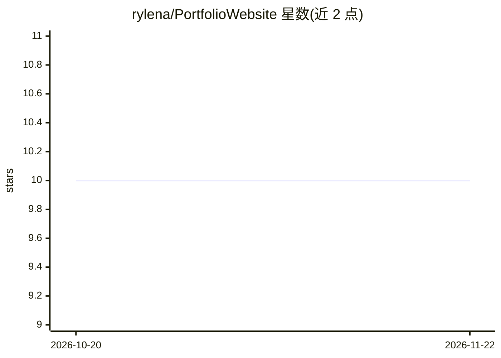

# rylena/PortfolioWebsite

⭐ 10 · HTML · 推送 2026-11-20 · [GitHub](https://github.com/rylena/PortfolioWebsite) · [官网](https://rylenanil.xyz) · 个人维护

**个人作品集与博客站点：展示网络安全研究与开发成果**

Rylen Anil 的官方作品集与博客，为静态站点。内容维护机制：Media 页面由 `data/media.json` 经 Python 脚本生成；博客图表以 Graphviz 源文件维护并通过脚本渲染 SVG；分享卡片由脚本用 Pillow 与 OFL 许可的 Poppins 字体生成 PNG 并写入 og:image 元数据。桌面端 GitHub 贡献日历调用公开 GitHub Contributions API 渲染 SVG，服务不可用时回退为个人主页链接，768px 以下隐藏该区块。

## 筛选速览

| 维度 | 判定 | 备注 |
|---|---|---|
| AI 角色 | `ai-enhanced` | 去掉 AI 部分产品仍成立 |
| 许可风险 | `none` | — |
| 部署形态 | `None` |  |
| 模型依赖 | — | README 未给出锁定关系 |
| 硬件要求 | — | 无带数字的原话,不猜 |
| 安装摩擦 | `low` | 无编译、无系统依赖或容器化 |
| 成熟度 | — | 结构信号不足 |

## 能力要点

- Media 页面由 data/media.json 经 build-media-page.py 脚本生成
- 博客图表用 Graphviz 源文件渲染 SVG，并同步图片尺寸
- 分享卡片脚本生成 1200×630 PNG 并维护 og:image URL 稳定性
- GitHub 贡献日历本地渲染 SVG，小屏隐藏且不发请求

## 适用场景

- 作为个人作品集展示研究与项目经历
- 以 JSON 数据驱动方式维护媒体报道列表
- 为博客文章自动生成分享预览图与图表

## 场景标签

 · 领域:个人网站/博客

## 证据(README 行号)

> L3: Official portfolio and blog for Rylen Anil.
> L5: The Media page is generated from `data/media.json`. Add or edit coverage there,
> L31: After editing those `.dot` files, run `python3 scripts/build-article-diagrams.py`

## 星数曲线

2026-10-20 10 → 2026-11-22 10（+0）

---
*卡片 v1 · prompt 1.4 · 生成 2026-11-19 · 置信度 mid · 依据 README sha `d773f6ccca9d` · [字段定义](../../DATASET.md)*
