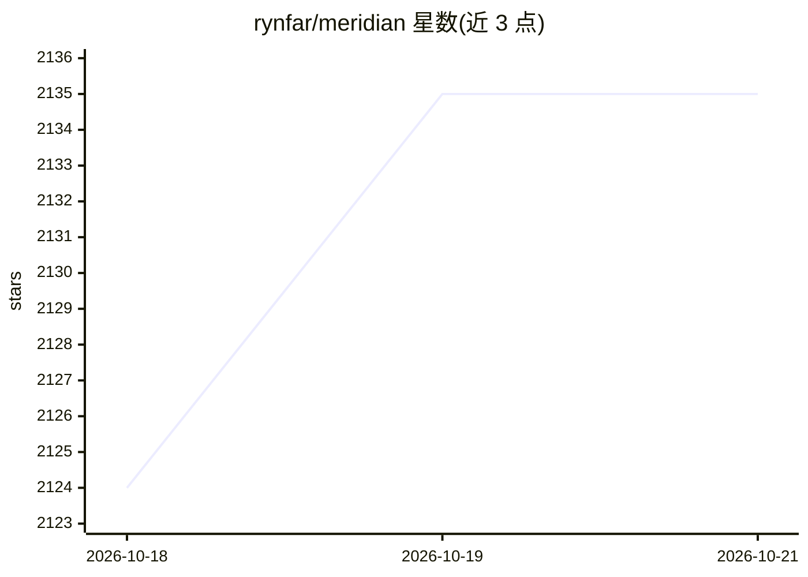

# rynfar/meridian

⭐ 2,135 · TypeScript · 推送 2026-10-19 · [GitHub](https://github.com/rynfar/meridian) · [官网](https://www.npmjs.com/package/@rynfar/meridian) · 个人维护

**让编码客户端经订阅使用 Claude/Antigravity 的本地 API 桥**

Meridian 将 Pi、OpenCode 等编码客户端连接到 Claude 与 Antigravity 订阅账户：Claude 请求经 Anthropic Agent SDK 转发，Antigravity 经官方 agy CLI（1.74.0 起为预览），本地提供 Anthropic Messages 与 OpenAI Chat Completions 兼容 API，并带用量仪表盘、请求历史与多账户路由。可选 Mac 桌面应用管理本地服务；npm 安装，支持 Docker/Nix 无头部署。Antigravity 仅在 macOS Apple Silicon 完成验证，Linux/Windows 验证未完成，上游 CLI 故障可中断会话。

## 筛选速览

| 维度 | 判定 | 备注 |
|---|---|---|
| AI 角色 | `ai-ecosystem` | LLM/agent 周边工具 |
| 许可风险 | `none` | — |
| 部署形态 | `library` | 以包/库形式分发 |
| 模型依赖 | locked-api |  |
| 硬件要求 | — | 无带数字的原话,不猜 |
| 安装摩擦 | `low` | 无编译、无系统依赖或容器化 |
| 成熟度 | `idea` | |

## 能力要点

- 以订阅账户为 Pi/OpenCode 等客户端提供本地 API（Anthropic Messages 与 OpenAI Chat Completions）
- Claude 经 Anthropic Agent SDK，Antigravity 经官方 agy CLI
- Web/macOS 用量仪表盘：配额、缓存活动、请求历史
- 签署并公证的 Mac DMG/ZIP 桌面应用，支持 Docker/Nix 无头运行

## 适用场景

- 在 Pi/OpenCode 等编码客户端中用自己的 Claude 订阅
- 本地统一管理 Claude 与 Antigravity 的账户、配额与请求
- 通过仪表盘追踪用量与缓存活动

## 场景标签

`模型网关` · 领域:Agent 开发

## 证据(README 行号)

> L13: Meridian connects coding clients to **Claude and Antigravity using your subscription**.
> L14: Run Pi, OpenCode or another supported client against a local API, and manage
> L118:  Pi, OpenCode and other supported clients connect to Meridian. Claude uses the Agent SDK; Antigravity uses the off

## 星数曲线

2026-10-18 2,124 → 2026-10-21 2,135（+11）

---
*卡片 v1 · prompt 1.4 · 生成 2026-10-21 · 置信度 high · 依据 README sha `1f2264969a43` · [字段定义](../../DATASET.md)*
