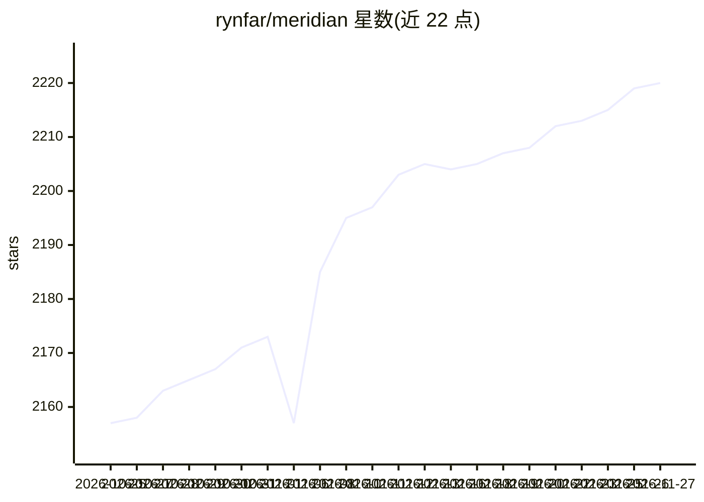

# rynfar/meridian

⭐ 2,220 · TypeScript · MIT · 推送 2026-11-23 · [GitHub](https://github.com/rynfar/meridian) · [官网](https://www.npmjs.com/package/@rynfar/meridian) · 个人维护

**本地 API 桥：让编码客户端接入 Claude/Antigravity 订阅**

本地 API 桥接服务，将 Pi、OpenCode 等编码客户端连接到用户自己的 Claude 与 Antigravity 订阅账户；Claude 请求经 Anthropic Agent SDK，Antigravity 请求经官方签名 agy CLI。提供浏览器用量面板、provider 管理和可选 macOS 桌面应用，支持会话复用、prompt caching、多账户 profile 与附件处理。发布通道为 npm 全局安装；Antigravity 处于预览阶段，Linux/Windows 认证验证未完成，部分工具结果对账等功能未完成。

## 筛选速览

| 维度 | 判定 | 备注 |
|---|---|---|
| AI 角色 | `ai-ecosystem` | LLM/agent 周边工具 |
| 许可风险 | `permissive` | MIT |
| 部署形态 | `library` | 以包/库形式分发 |
| 模型依赖 | locked-api |  |
| 硬件要求 | — | 无带数字的原话,不猜 |
| 安装摩擦 | `low` | 无编译、无系统依赖或容器化 |
| 成熟度 | `idea` | |

## 能力要点

- 支持 Anthropic Messages、OpenAI Chat Completions 及部分 Responses 客户端 API
- Claude/Antigravity 双后端，各用独立签名账户，配额状态分开展示
- 可选 macOS（Apple Silicon）桌面应用管理服务、版本、插件与诊断
- Docker、Nix 与 headless 服务运行方式

## 适用场景

- 让 Pi/OpenCode 等客户端使用已有的 Claude 订阅
- 集中管理多个 provider 账户的请求与用量
- 无界面服务器上运行编码客户端桥接服务

## 场景标签

`模型网关` · 领域:Agent 开发

## 证据(README 行号)

> L13: Meridian connects coding clients to **Claude and Antigravity using your subscription**.
> L17: Claude requests run through Anthropic’s Agent SDK. Antigravity requests run
> L121: Meridian translates supported client requests at the provider boundary. It keeps

## 星数曲线

2026-10-25 2,157 → 2026-11-27 2,220（+63）

---
*卡片 v1 · prompt 1.4 · 生成 2026-11-24 · 置信度 high · 依据 README sha `5054036b875a` · [字段定义](../../DATASET.md)*
