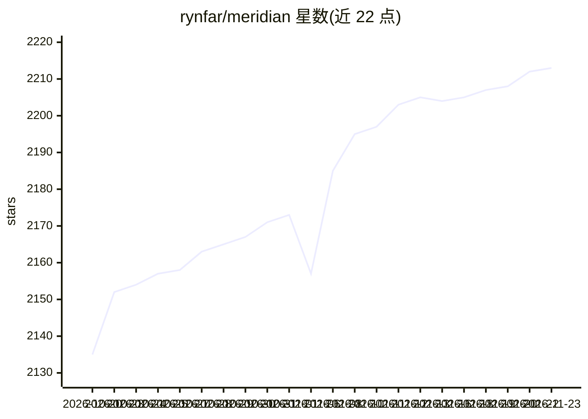

# rynfar/meridian

⭐ 2,213 · TypeScript · MIT · 推送 2026-11-20 · [GitHub](https://github.com/rynfar/meridian) · [官网](https://www.npmjs.com/package/@rynfar/meridian) · 个人维护

**让编码客户端经本地 API 使用 Claude/Antigravity 订阅**

本地 API 桥接服务：将 Pi、OpenCode 等编码客户端接入 Claude 与 Antigravity，复用用户的订阅账号。Claude 请求经 Anthropic Agent SDK 转发，Antigravity 请求经 Google 官方 agy CLI 处理；提供浏览器用量面板、提供方管理与可选的 macOS 桌面应用。支持 Anthropic Messages 与 OpenAI Chat Completions 客户端接口、附件转换、会话复用与恢复；账号配额与模型可用性限制仍由上游订阅决定，Linux/Windows 鉴权验证未完成。

## 筛选速览

| 维度 | 判定 | 备注 |
|---|---|---|
| AI 角色 | `ai-ecosystem` | LLM/agent 周边工具 |
| 许可风险 | `permissive` | MIT |
| 部署形态 | `library` | 以包/库形式分发 |
| 模型依赖 | locked-api |  |
| 硬件要求 | — | 无带数字的原话,不猜 |
| 安装摩擦 | `low` | 无编译、无系统依赖或容器化 |
| 成熟度 | — | 结构信号不足 |

## 能力要点

- 本地 API 桥接 Claude（Agent SDK）与 Antigravity（agy CLI），复用订阅账号
- 暴露 Anthropic Messages 与 OpenAI Chat Completions 兼容客户端接口
- 浏览器/桌面用量仪表盘：请求历史、配额状态与缓存活动
- npm 全局安装即用，支持 Docker/Nix/headless 部署与多账号配置

## 适用场景

- 在 Pi 或 OpenCode 中使用自己的 Claude 订阅而非按量 API key
- 统一查看多个编码客户端的请求记录与用量
- 在无 GUI 的服务器上以 headless 方式运行本地桥接服务

## 场景标签

`模型网关` · 领域:Agent 开发

## 证据(README 行号)

> L13: Meridian connects coding clients to **Claude and Antigravity using your subscription**.
> L121: Meridian translates supported client requests at the provider boundary. It keeps

## 星数曲线

2026-10-20 2,135 → 2026-11-23 2,213（+78）

---
*卡片 v1 · prompt 1.4 · 生成 2026-11-23 · 置信度 high · 依据 README sha `64e771c53f0a` · [字段定义](../../DATASET.md)*
