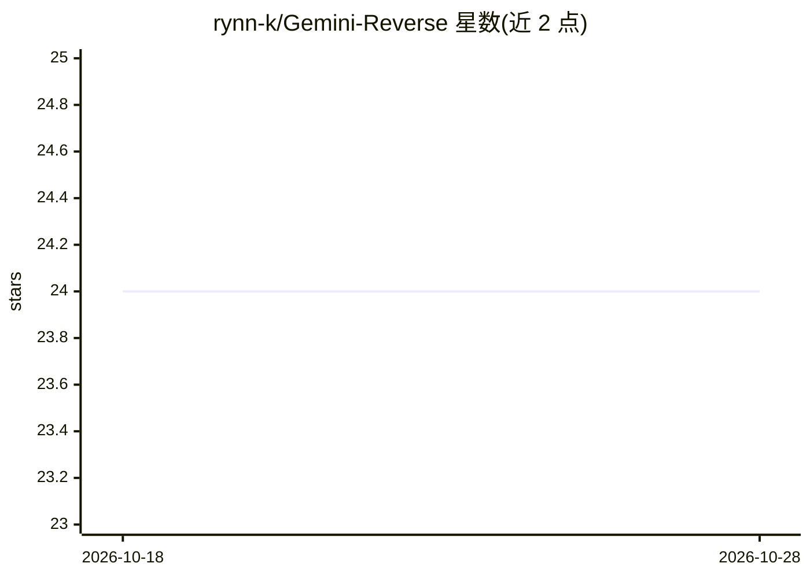

# rynn-k/Gemini-Reverse

⭐ 24 · JavaScript · MIT · 推送 2026-06-23 · [GitHub](https://github.com/rynn-k/Gemini-Reverse) · [官网](https://www.npmjs.com/package/gemini-reverse) · 个人维护

**gemini.google.com 网页端的非官方 Node.js 客户端库**

通过逆向 gemini.google.com 网页接口封装的 Node.js/TypeScript 库，以 npm 包形式提供。用 __Secure-1PSID Cookie 认证，也支持无需账号的访客模式（限 Flash 模型）。功能覆盖多轮会话、流式输出、文件输入、图像/视频/音频生成、深度研究、扩展思考、Gems 系统提示管理与对话历史管理。用户通过它直接获得 Gemini 的生成结果。依赖网页端 Cookie，接口为非官方途径。

## 筛选速览

| 维度 | 判定 | 备注 |
|---|---|---|
| AI 角色 | `ai-ecosystem` | LLM/agent 周边工具 |
| 许可风险 | `permissive` | MIT |
| 部署形态 | `library` | 以包/库形式分发 |
| 模型依赖 | — | README 未给出锁定关系 |
| 硬件要求 | — | 无带数字的原话,不猜 |
| 安装摩擦 | `low` | 无编译、无系统依赖或容器化 |
| 成熟度 | — | 结构信号不足 |

## 能力要点

- 访客模式无需 Google 账号或 Cookie 即可多轮对话
- 支持图像/视频/音频生成与流式输出
- 通过 Gems 实现系统提示，支持自定义 Gem 的增删改
- 会话元数据可持久化以跨进程恢复对话

## 适用场景

- 在 Node.js 项目中调用 Gemini 网页端能力生成文本/图像/视频
- 无 Google 账号时以访客模式快速试用 Gemini
- 程序化管理 Gems 与对话历史

## 场景标签

`图像生成` `视频生成` · 领域:内容生成

## 证据(README 行号)

> L5: An unofficial Node.js client for Google Gemini, inspired by Gemini-API — a Python reverse engineering project by @Ha
> L25: npm install gemini-reverse

## 星数曲线

2026-10-18 24 → 2026-10-28 24（+0）

---
*卡片 v1 · prompt 1.4 · 生成 2026-10-27 · 置信度 high · 依据 README sha `6a9fae7ff9f1` · [字段定义](../../DATASET.md)*
