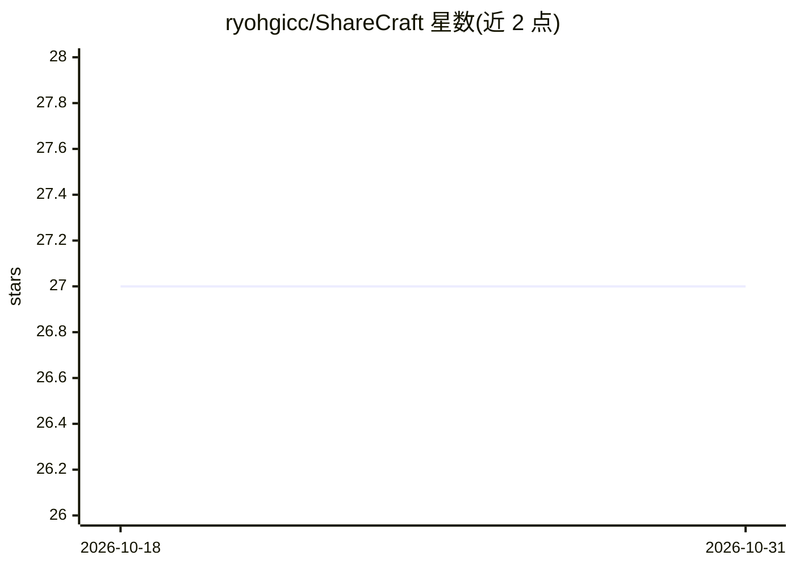

# ryohgicc/ShareCraft

⭐ 27 · JavaScript · 推送 2026-10-09 · [GitHub](https://github.com/ryohgicc/ShareCraft) · 个人维护 · 中文 README

**浏览器插件：一键把网页生成可转发的多风格推荐语**

Chrome/Edge MV3 浏览器扩展，面向需要分享链接的个人用户。打开网页点一下插件，AI 读取页面内容并按 4 种内置模板（朋友安利/金句安利/详细安利/自定义润色）并发生成推荐语，一键复制「推荐语+链接」粘贴到微信/飞书/Slack/Discord。用户自带 API Key，支持 OpenAI 与 Anthropic 协议及兼容网关（DeepSeek/Moonshot/OpenRouter 等），Key 仅存浏览器本地，请求直连端点无中间服务器。通过开发者模式加载已解压目录安装，无中间服务器中转。限制：浏览器内部页面无法读取。

## 筛选速览

| 维度 | 判定 | 备注 |
|---|---|---|
| AI 角色 | `ai-native` | 本体是模型或模型工具 |
| 许可风险 | `none` | — |
| 部署形态 | `None` |  |
| 模型依赖 | — | README 未给出锁定关系 |
| 硬件要求 | — | 无带数字的原话,不猜 |
| 安装摩擦 | `low` | 无编译、无系统依赖或容器化 |
| 成熟度 | — | 结构信号不足 |

## 能力要点

- 多模板并发生成，总耗时约等于最慢一条
- 用户自带 API Key，支持 OpenAI/Anthropic 协议及任意 OpenAI 兼容网关
- API Key 仅存浏览器本地，请求直发所配端点，无中间服务器
- 支持 8 种输出语言锁定、每模板字符上限与 prompt 可编辑

## 适用场景

- 把感兴趣的网页一键转成推荐语分享到微信/Slack/Discord 群
- 用自己的点评结合 AI 润色生成个性化分享文案
- 用自己的 LLM API Key 在浏览器里生成文案，不经过第三方服务器

## 场景标签

`AI 写作` · 领域:内容生成

## 证据(README 行号)

> L5: 每次想分享一个链接给朋友或群里，是不是都卡在"怎么写一句话让人想点开"？ShareCraft 帮你跳过这一步——打开任意网页，点一下插件图标，AI 自动读取页面内容，并发生成多条不同风格的推荐语，复制即用。
> L25: 支持 OpenAI 和 Anthropic 协议（含兼容网关：DeepSeek / Moonshot / OpenRouter / 自建反代等）。API Key 只存在浏览器本地，不经过任何第三方服务器。

## 星数曲线

2026-10-18 27 → 2026-10-31 27（+0）

---
*卡片 v1 · prompt 1.4 · 生成 2026-10-26 · 置信度 high · 依据 README sha `12578cb7bb8b` · [字段定义](../../DATASET.md)*
