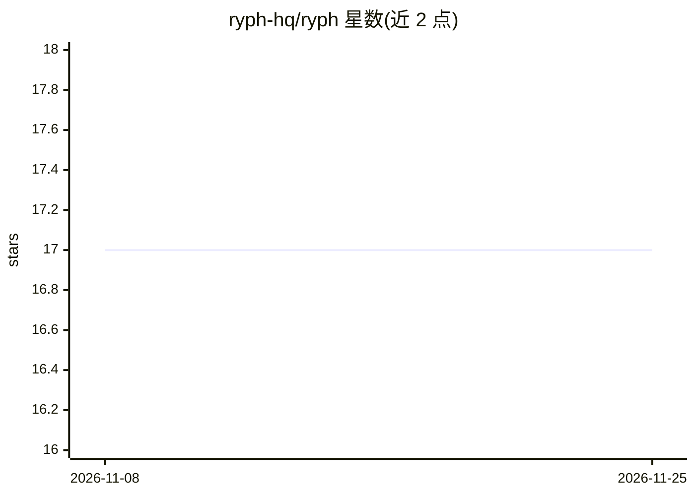

# ryph-hq/ryph

⭐ 17 · TypeScript · MIT · 推送 2026-11-09 · [GitHub](https://github.com/ryph-hq/ryph) · [官网](https://ryph.ai) · 组织维护

**团队自托管的编码 agent 编排平台：告警响应、聊天协作、PR 交付**

面向团队的自托管 agent 编排平台（batteries-included orchestrator）。收到告警 webhook（Grafana/PagerDuty/Sentry 等）后在自有基础设施内启动安全沙箱容器运行编码 agent：读遥测数据诊断、在事件聊天（Slack/Telegram/Zulip）中汇报、构建修复并提交 PR，含 forge 防护防止绕过代码评审。也支持 UI 任务、聊天提及、/ryph 评论、cron 定时触发。模型经 model-proxy 代理访问（真实密钥不进容器），工具经 MCP gateway 接入。发布形态为单二进制（内嵌 Postgres）、Docker Compose、Helm Chart（Kubernetes 自动扩缩）。声明 v1 前可能存在破坏性变更。

## 筛选速览

| 维度 | 判定 | 备注 |
|---|---|---|
| AI 角色 | `ai-ecosystem` | LLM/agent 周边工具 |
| 许可风险 | `permissive` | MIT |
| 部署形态 | `self-host` | docker 或自建部署 |
| 模型依赖 | — | README 未给出锁定关系 |
| 硬件要求 | — | 无带数字的原话,不猜 |
| 安装摩擦 | `low` | 无编译、无系统依赖或容器化 |
| 成熟度 | `idea` | |

## 能力要点

- 告警→沙箱 agent 诊断→修复 PR 的端到端事件响应流程
- model-proxy / mcp-gateway 数据面：真实密钥不进入运行容器
- 支持 Slack/Telegram/Zulip 聊天协作与多告警源、多 forge（GitHub/GitLab/Radicle）
- 单二进制 / Docker Compose / Helm Chart 三种部署形态

## 适用场景

- 值班团队部署自托管事件响应机器人，自动诊断并提交热修复 PR
- 在 Slack/Discord/Telegram 中为团队提供可读写代码库的安全助手 agent
- 通过 /ryph 评论、UI 任务或定时计划触发编码 agent 运行

## 场景标签

`编码 Agent` `Agent 框架` · 领域:Agent 开发

## 证据(README 行号)

> L15: Ryph is a complete, batteries-included agent orchestrator for teams that's easy to deploy and put
> L75: Ryph is the self-hosted platform that does all this and more: coding agents that run in secure
> L126:  models and tools through ryph's proxies and never sees a real key

## 星数曲线

2026-11-08 17 → 2026-11-25 17（+0）

---
*卡片 v1 · prompt 1.4 · 生成 2026-11-18 · 置信度 high · 依据 README sha `8a55cfb29ed1` · [字段定义](../../DATASET.md)*
