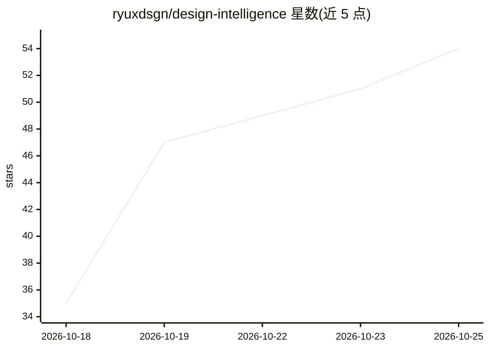

# ryuxdsgn/design-intelligence

⭐ 54 · TypeScript · MIT · 推送 2026-10-24 · [GitHub](https://github.com/ryuxdsgn/design-intelligence) · [官网](https://ryux.design) · 组织维护

**给 AI 编码/设计 agent 的设计决策技能包**

RYUX 是一套安装到 AI agent 中的设计智能技能：包含路由器 SKILL.md、五个能力文件（Analyze/Design/Build/Critique/QA）与设计规则知识模块。工作流为理解、框定问题、探索两三个方案、按 brief 评估、构建并评审、验证；任务前区分已知事实、设计假设与未确认能力，每个决策附带证据与置信度收据，规则分级且设硬性门槛（禁止编造数字、禁止缺失关键状态）。面向产品设计师、使用 AI 编码 agent 的开发者与设计工程师。通过 npx 安装器、skills.sh、Claude Code 插件等分发，另有本地 MCP server；参考屏幕的托管 MCP 与参考库尚未发布。自称 early access。

## 筛选速览

| 维度 | 判定 | 备注 |
|---|---|---|
| AI 角色 | `ai-ecosystem` | LLM/agent 周边工具 |
| 许可风险 | `permissive` | MIT |
| 部署形态 | `library` | 以包/库形式分发 |
| 模型依赖 | — | README 未给出锁定关系 |
| 硬件要求 | — | 无带数字的原话,不猜 |
| 安装摩擦 | `low` | 无编译、无系统依赖或容器化 |
| 成熟度 | `idea` | |

## 能力要点

- 五能力工作流：Analyze/Design/Build/Critique/QA
- 决策收据：证据、置信度与假设标注，区分事实与假设
- 规则分级（Required/Preferred/Contextual）加硬性门槛
- 支持 npx 安装器、skills.sh、Claude Code/Codex/Copilot/VS Code/Gemini CLI 插件

## 适用场景

- 让 AI 编码 agent 在设计 UI 前先提问、列假设而非直接编造
- 对已有界面做启发式评审与可访问性检查
- 构建后按设计与多宽度/状态做 QA 核验

## 场景标签

`提示工程` · 领域:Agent 开发

## 证据(README 行号)

> L11: RYUX helps AI agents make better-informed design decisions. It gives them a structured way to
> L145: One skill folder, `ryux/`: a router (`SKILL.md`) that picks the step, five capability files, and
> L108: `/plugin install ryux@design-intelligence`), Codex, GitHub Copilot, VS Code, and Gemini CLI. The

## 星数曲线

2026-10-18 35 → 2026-10-25 54（+19）

---
*卡片 v1 · prompt 1.4 · 生成 2026-10-24 · 置信度 high · 依据 README sha `ad75770e2310` · [字段定义](../../DATASET.md)*
