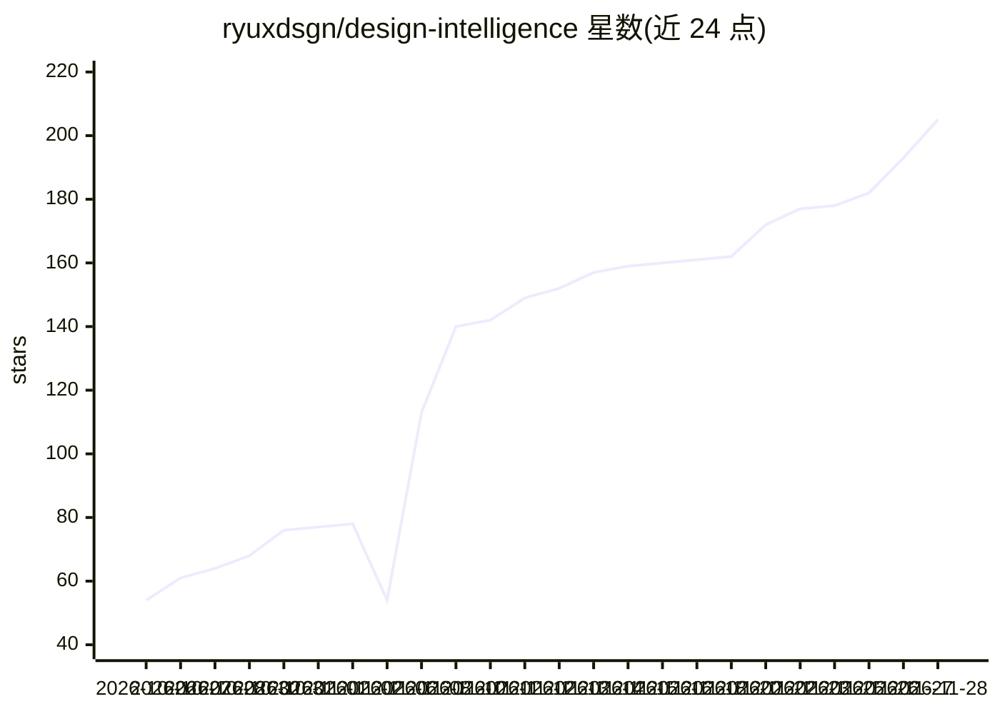

# ryuxdsgn/design-intelligence

⭐ 205 · TypeScript · MIT · 推送 2026-11-27 · [GitHub](https://github.com/ryuxdsgn/design-intelligence) · [官网](https://ryux.design) · 个人维护

**给 AI agent 补设计流程能力的技能包：先问后做、可批判可验证**

RYUX 是一个面向 AI 编码 agent 的设计技能与配套 CLI：内置路由 skill 将任务分为 Analyze/Design/Build/Critique/QA 五类步骤，工作流要求先理解产品上下文、列出未决项而非编造业务规则，每个任务结束输出已验证/未验证报告。CLI 的 scan 以 Rust 编译的 WebAssembly 运行无 LLM 检查（可访问性、货币格式、布局），支持 CI 中 exit 1 失败与编辑钩子回传发现。兼容 Claude Code、Codex、Cursor、Gemini CLI 等多种 agent。基准文档同时公布 RYUX 落败的一项基准与 1.5-7 倍的运行成本。

## 筛选速览

| 维度 | 判定 | 备注 |
|---|---|---|
| AI 角色 | `ai-ecosystem` | LLM/agent 周边工具 |
| 许可风险 | `permissive` | MIT |
| 部署形态 | `library` | 以包/库形式分发 |
| 模型依赖 | — | README 未给出锁定关系 |
| 硬件要求 | — | 无带数字的原话,不猜 |
| 安装摩擦 | `low` | 无编译、无系统依赖或容器化 |
| 成熟度 | `idea` | |

## 能力要点

- skill 路由分发 Analyze/Design/Build/Critique/QA 五类任务并要求先提问后设计
- scan 检查以 Rust/WASM 运行，无 LLM 与 API key，exit 1 可接入 CI
- 支持 Figma 库读取生成 DESIGN.md，未决事项以标注列出而非编造
- --hook 将每次编辑的检查结果回传给 Claude Code/Codex/Cursor/OpenCode

## 适用场景

- 让 agent 在没有完整需求时先提问再生成界面
- 对已有前端页面做多宽度可访问性与布局扫描
- 从 Figma 文件生成团队 DESIGN.md 设计规范
- 在 CI 中对构建结果与设计稿做一致性 QA

## 场景标签

`编码 Agent` `Agent 框架` · 领域:Agent 开发

## 证据(README 行号)

> L10: A design skill for AI agents. Your agent asks about the product before it designs, keeps what it does not know
> L92: `scan` checks what a machine can see, with no LLM and no API key. The checks are written in Rust and run as
> L119: `npx --no-install @ryuxdsgn/design-intelligence scan` from the project. In auto mode, Claude Code can refuse a

## 星数曲线

2026-10-26 54 → 2026-11-28 205（+151）

---
*卡片 v1 · prompt 1.4 · 生成 2026-11-26 · 置信度 high · 依据 README sha `0217c1267ff3` · [字段定义](../../DATASET.md)*
