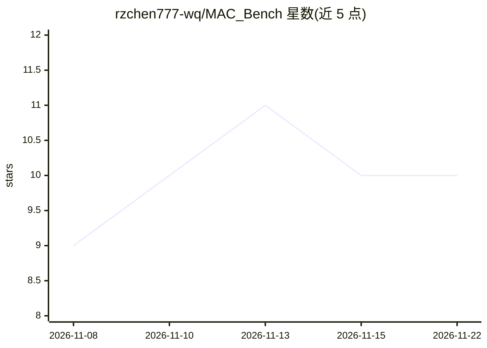

# rzchen777-wq/MAC_Bench

⭐ 10 · Python · MIT · 推送 2026-11-17 · [GitHub](https://github.com/rzchen777-wq/MAC_Bench) · [官网](https://huggingface.co/datasets/sihuichuibuqi/MAC-Bench) · 个人维护

**多智能体协作能力基准：以互联任务评测 agent 团队**

MAC-Bench 通过业务运营与软件工程两类领域的互联任务评测多智能体协作：任务组件之间交换输出或共享资源，结果需相互契合；用户自选 agent、分工与通信方式组成被测系统。覆盖 Finance、服务管理等两域六类，每类 8 个测试任务与 1 个开发任务。评估从应用记录与软件产物中核验部分进度（PS）与完整解决率（RR），任务环境托管在 Modal 或 Daytona，本地运行评估器，配合支持 chat completions 与 tool calls 的模型端点。MIT 许可，需 Python 3.11+。

## 筛选速览

| 维度 | 判定 | 备注 |
|---|---|---|
| AI 角色 | `ai-ecosystem` | LLM/agent 周边工具 |
| 许可风险 | `permissive` | MIT |
| 部署形态 | `library` | 以包/库形式分发 |
| 模型依赖 | — | README 未给出锁定关系 |
| 硬件要求 | — | 无带数字的原话,不猜 |
| 安装摩擦 | `low` | 无编译、无系统依赖或容器化 |
| 成熟度 | — | 结构信号不足 |

## 能力要点

- 互联任务设计：组件交换输出/共享资源，结果需协同
- 两域六类任务，每类 8 测试 + 1 开发任务
- 输出 Progress Score 与 Resolution Rate 双指标及 episode 轨迹
- 支持 Modal 与 Daytona 两种任务环境托管方式

## 适用场景

- 评测自研多智能体系统在业务流程任务中的协作能力
- 比较不同 agent 分工与通信策略的任务完成率
- 为多智能体框架挑选软件工程类评测任务

## 场景标签

`模型评测` · 领域:评测与运维

## 证据(README 行号)

> L17: MAC-Bench evaluates multi-agent collaboration through **interconnected tasks** in **business operations** and **sof
> L135: Use **Python 3.11+ on Linux**, a Modal or Daytona account, and a model endpoint supporting chat completions and to

## 星数曲线

2026-11-08 9 → 2026-11-22 10（+1）

---
*卡片 v1 · prompt 1.4 · 生成 2026-11-19 · 置信度 high · 依据 README sha `9f258adcddaa` · [字段定义](../../DATASET.md)*
