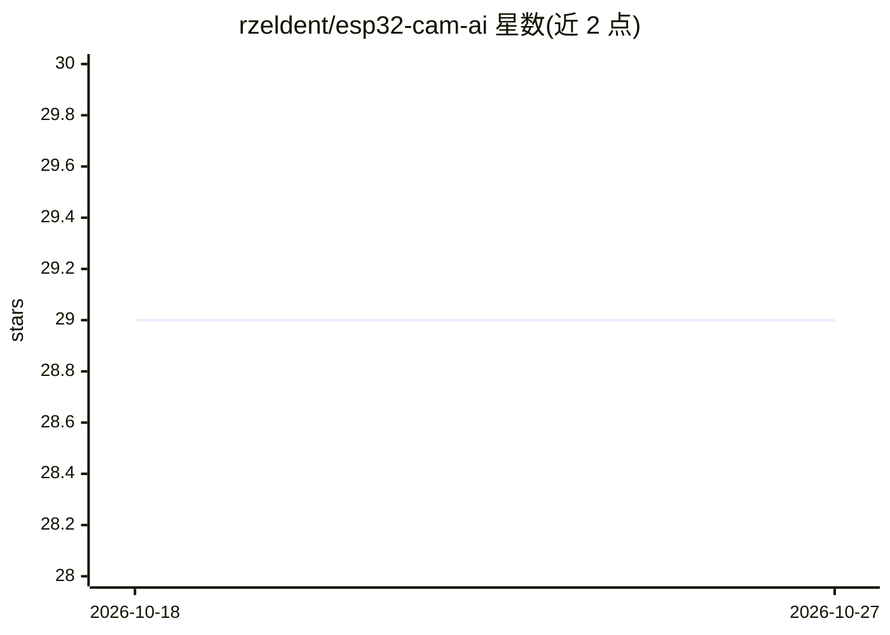

# rzeldent/esp32-cam-ai

⭐ 29 · C++ · MIT · 推送 2026-09-29 · [GitHub](https://github.com/rzeldent/esp32-cam-ai) · [官网](https://github.com/rzeldent/ESP32-CAM-AI) · 个人维护

**让 LLM/AI 助手通过 MCP 远程控制 ESP32-CAM 的固件**

运行在 ESP32-CAM（Arduino/C++）上的 MCP 服务器固件，实现 MCP 2025-06-18 协议，向 Copilot、VSCode AI-Toolkit、Home Assistant、Node-RED 等 AI 助手与自动化系统暴露标准化工具：拍照（base64 JPEG，控制在 4KB 内）、LED/闪光灯控制、GPIO 读写、WiFi 与系统状态诊断。支持 mDNS 发现、OTA 升级与看门狗。开发流程为 PlatformIO 构建上传，需 FTDI 串口适配器初次烧录；当前仅启用 AI-Thinker 板型配置。

## 筛选速览

| 维度 | 判定 | 备注 |
|---|---|---|
| AI 角色 | `ai-ecosystem` | LLM/agent 周边工具 |
| 许可风险 | `permissive` | MIT |
| 部署形态 | `None` |  |
| 模型依赖 | — | README 未给出锁定关系 |
| 硬件要求 | — | 无带数字的原话,不猜 |
| 安装摩擦 | `low` | 无编译、无系统依赖或容器化 |
| 成熟度 | — | 结构信号不足 |

## 能力要点

- 实现 MCP 2025-06-18 协议，暴露拍照/LED/GPIO/系统诊断等 JSON-RPC 工具
- 拍照输出 base64 JPEG 并优化至 4KB 以内，可配闪光与分辨率
- GPIO 工具按芯片与板定义动态校验可用引脚
- 支持 mDNS 发现、OTA 固件升级与看门狗恢复

## 适用场景

- 用 AI 助手自然语言指令控制 ESP32-CAM 拍照或开关 LED
- 在 Home Assistant / Node-RED 中接入摄像头做自动化
- 通过 MCP 客户端远程监控设备的 WiFi 与内存状态

## 场景标签

 · 领域:物联网/LLM 工具接入

## 证据(README 行号)

> L17: This project transforms an ESP32-CAM into a remotely controllable MCP server that can capture images, control LEDs,
> L19: Brief: **Use Copilot or other AI digital assistants, like AI-Toolkit (in VSCode), Home Assistant (HA) or Node-Red, 
> L47: - **Standard Compliance**: Full MCP 2025-06-18 protocol implementation

## 星数曲线

2026-10-18 29 → 2026-10-27 29（+0）

---
*卡片 v1 · prompt 1.4 · 生成 2026-10-26 · 置信度 high · 依据 README sha `fb6aef762abd` · [字段定义](../../DATASET.md)*
