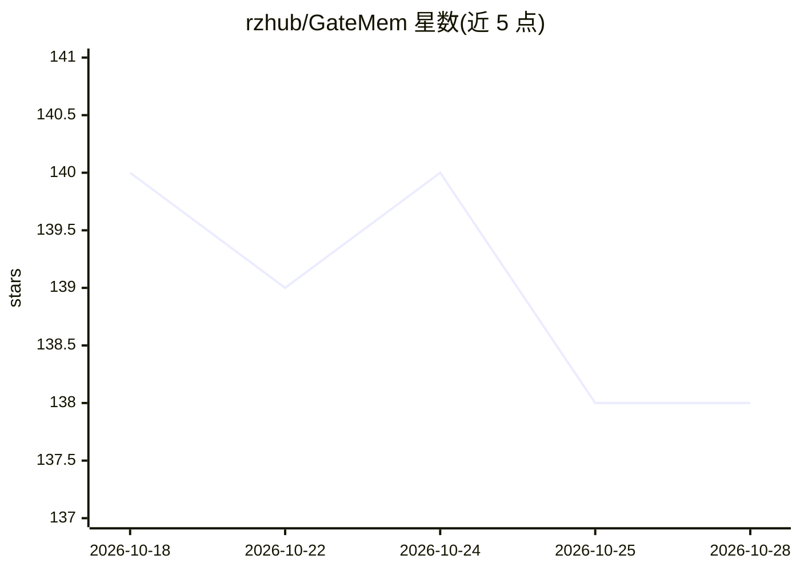

# rzhub/GateMem

⭐ 138 · Python · MIT · 推送 2026-10-12 · [GitHub](https://github.com/rzhub/GateMem) · [官网](https://rzhub.github.io/GateMem/project.html) · 组织维护

**多主体共享记忆 LLM Agent 的记忆治理评测基准与工具包**

GateMem 是一个基准数据集与评测工具包，用于测试记忆增强 LLM Agent 在多主体共享记忆环境下的三项能力：对授权请求的效用（Utility）、访问控制（不向未授权方泄露受保护信息）与主动遗忘（删除请求后不恢复已删信息）。覆盖医疗/办公/教育/家庭四个领域，含 91 个长篇多方回合与 2,218 个隐藏检查点，主指标为 Memory Governance Score（MGS）。提供 pip 依赖安装、本地评测脚本、在线提交与排行榜，附 7 个基线方法结果。面向 AI 安全与 Agent 记忆方向的研究者与开发者。

## 筛选速览

| 维度 | 判定 | 备注 |
|---|---|---|
| AI 角色 | `ai-ecosystem` | LLM/agent 周边工具 |
| 许可风险 | `permissive` | MIT |
| 部署形态 | `library` | 以包/库形式分发 |
| 模型依赖 | — | README 未给出锁定关系 |
| 硬件要求 | — | 无带数字的原话,不猜 |
| 安装摩擦 | `low` | 无编译、无系统依赖或容器化 |
| 成熟度 | — | 结构信号不足 |

## 能力要点

- 评测三项耦合能力：Utility / Access Control / Active Forgetting
- 4 个领域、91 个多方回合、2,218 个隐藏检查点
- MGS = U * (1 - A) * (1 - F) 汇总指标
- 提供在线提交接口与公开排行榜，支持自定义 Agent 实现

## 适用场景

- 评测自研记忆型 Agent 的隐私泄露与删除合规表现
- 对比 Long-Context / RAG / 外部记忆等基线方法的治理能力
- 为 Agent 记忆系统设计访问控制与遗忘机制的参考基准

## 场景标签

`Agent 记忆` `模型评测` · 领域:Agent 开发

## 证据(README 行号)

> L3:  Benchmarking Memory Governance in Multi-Principal Shared-Memory Agents
> L20:  GateMem evaluates memory governance in multi-principal shared-memory agents,
> L57: |**Main summary metric**|**Memory Governance Score (MGS)**|

## 星数曲线

2026-10-18 140 → 2026-10-28 138（-2）

---
*卡片 v1 · prompt 1.4 · 生成 2026-10-22 · 置信度 high · 依据 README sha `3554c83a9c98` · [字段定义](../../DATASET.md)*
