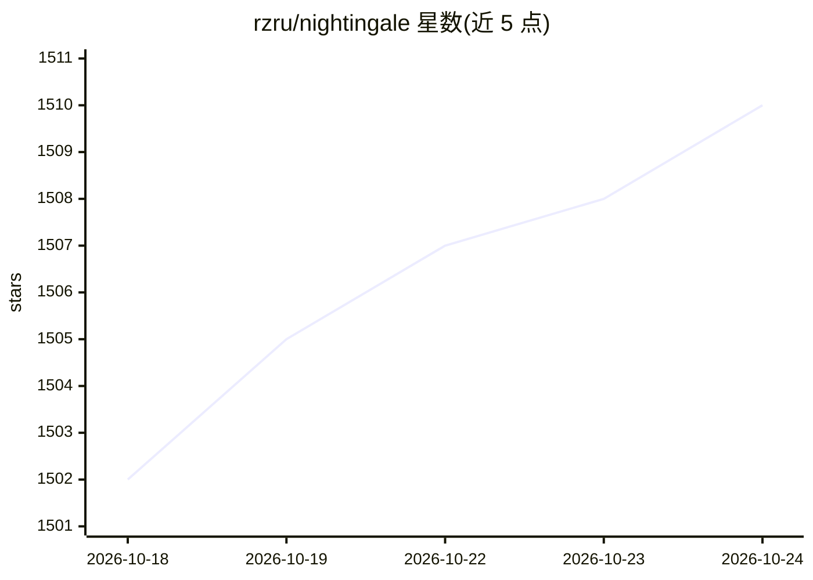

# rzru/nightingale

⭐ 1,510 · TypeScript · GPL-3.0 · 推送 2026-10-19 · [GitHub](https://github.com/rzru/nightingale) · [官网](https://nightingale.cafe) · 个人维护

**本地音乐库的 AI 卡拉OK应用：分离人声、生成歌词、打分**

桌面（Tauri）与自托管 Web 双形态的卡拉OK应用，Rust 核心 + React 前端。可扫描本地音频/视频/UltraStar 文件，或接入 Plex、Jellyfin、Navidrome。AI 部分：用 UVR Karaoke 或 Demucs 分离人声，通过 LRCLIB、本地 LRC 或自动转录对齐生成逐字歌词。支持同步歌词高亮、麦克风音高评分、变速变调、2-4 人本地多人。分析产物按 BLAKE3 哈希缓存，首启下载若干 GB 的隔离运行时与模型，GPU 加速可选，无 CUDA/Apple Silicon 时回退 CPU。

## 筛选速览

| 维度 | 判定 | 备注 |
|---|---|---|
| AI 角色 | `ai-enhanced` | 去掉 AI 部分产品仍成立 |
| 许可风险 | `viral` | GPL-3.0 |
| 部署形态 | `self-host` | docker 或自建部署 |
| 模型依赖 | — | README 未给出锁定关系 |
| 硬件要求 | — | 无带数字的原话,不猜 |
| 安装摩擦 | `low` | 无编译、无系统依赖或容器化 |
| 成熟度 | — | 结构信号不足 |

## 能力要点

- UVR Karaoke / Demucs 本地分离人声，LRCLIB 或自动转录生成对齐歌词
- 桌面与自托管 Web 共享同一 Rust 核心与 React 前端
- 音高评分、变速变调、2-4 人本地多人、队列与 Session 模式
- 分析进程常驻并按源哈希缓存 stems/转录/歌词

## 适用场景

- 把已有音乐库变成可打分的卡拉OK曲库
- 派对上多人同唱并比拼分数
- 自托管 Web 模式在大屏或手机上办卡拉OK之夜

## 场景标签

`语音识别` · 领域:感知与多模态

## 证据(README 行号)

> L18: Nightingale turns music you already have into karaoke. It can separate lead vocals, find or produce word-timed lyri
> L23: - **Prepare tracks locally** — separate vocals with UVR Karaoke or Demucs, then use LRCLIB, local or pasted LRC, or

## 星数曲线

2026-10-18 1,502 → 2026-10-24 1,510（+8）

---
*卡片 v1 · prompt 1.4 · 生成 2026-10-21 · 置信度 high · 依据 README sha `e99695d3b349` · [字段定义](../../DATASET.md)*
