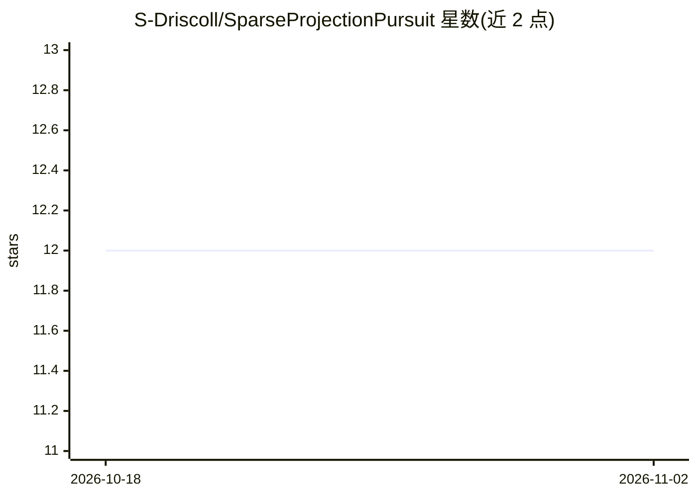

# S-Driscoll/SparseProjectionPursuit

⭐ 12 · MATLAB · 推送 2026-06-08 · [GitHub](https://github.com/S-Driscoll/SparseProjectionPursuit) · 个人维护

**MATLAB 实现的稀疏投影寻踪算法，用于高维化学数据探索**

提供 SPPA.m MATLAB 函数，执行基于峰度优化的稀疏投影寻踪分析：用遗传算法选择原始变量子集，使 PPA 摆脱对 PCA 预压缩的依赖，缓解低样本-变量比下的过拟合问题。面向化学计量学与多变量数据分析的研究者，仓库含算法代码、demo.m 示例（鲑鱼血浆 NMR 数据集）及 2020 年论文引用信息。主分支为 1.0 版本，1.1 分支改进初始种群选择以均匀覆盖变量。

## 筛选速览

| 维度 | 判定 | 备注 |
|---|---|---|
| AI 角色 | `ai-native` | 本体是模型或模型工具 |
| 许可风险 | `none` | — |
| 部署形态 | `None` |  |
| 模型依赖 | — | README 未给出锁定关系 |
| 硬件要求 | — | 无带数字的原话,不猜 |
| 安装摩擦 | `low` | 无编译、无系统依赖或容器化 |
| 成熟度 | — | 结构信号不足 |

## 能力要点

- 基于峰度优化的投影寻踪，区别于 PCA/HCA 等方差类方法
- 遗传算法选择变量子集，使 PPA 不依赖 PCA 预压缩
- 提供 demo.m 示例（NMR 光谱数据）
- 多分支版本：1.1 改进初始种群覆盖

## 适用场景

- 对高维化学计量数据做探索性投影分析
- 样本-变量比偏低时寻找稀疏变量子集投影
- 复现 2020 年 SPPA 论文方法

## 场景标签

`数据分析` · 领域:效率与自动化

## 证据(README 行号)

> L11: `SPPA.m` is a MATLAB function to perform sparse kurtosis-based projection pursuit using a genetic algorithm.
> L5: Kurtosis-based projection pursuit analysis (PPA) was developed as an alternative exploratory data analysis algorithm

## 星数曲线

2026-10-18 12 → 2026-11-02 12（+0）

---
*卡片 v1 · prompt 1.4 · 生成 2026-11-01 · 置信度 high · 依据 README sha `3551a7f855df` · [字段定义](../../DATASET.md)*
