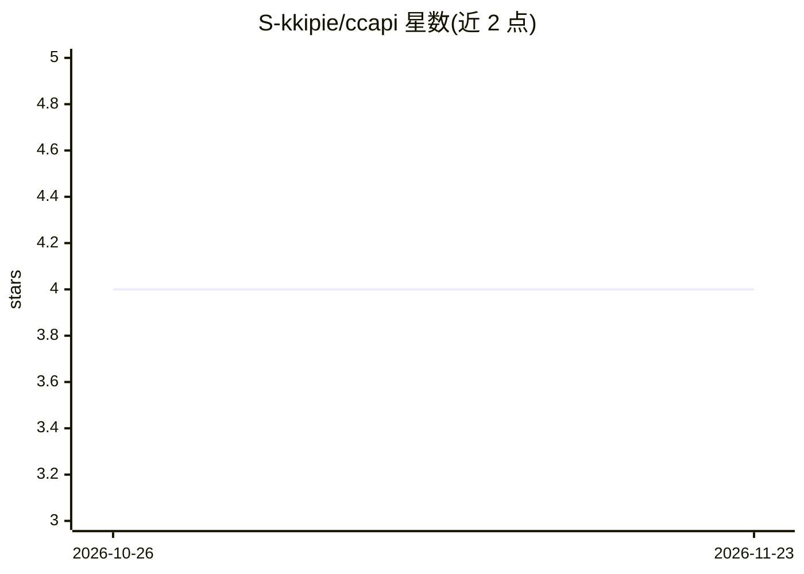

# S-kkipie/ccapi

⭐ 4 · TypeScript · MIT · 推送 2026-11-22 · [GitHub](https://github.com/S-kkipie/ccapi) · 个人维护

**把 Claude Code 订阅变成本地 Anthropic 兼容 API 的代理**

ccapi 通过在 tmux 中运行带两个 mod 的 Claude Code 会话，在 127.0.0.1 上提供 Anthropic Messages API 的 /v1/messages 端点，使脚本、LiteLLM、Agent 框架等任何 Anthropic SDK 客户端无需改代码即可复用已付费的 Claude Code 订阅。支持工具调用（含并行）、图片与 PDF、SSE 流式输出、扩展思考、多模型列表与请求日志。限制：不支持结构化输出、Message Batches、Files API；仅限本机个人使用，订阅用量按正常会话消耗。依赖 Claude Code ≥2.1.291、Bun 与 tmux，MIT 许可。

## 筛选速览

| 维度 | 判定 | 备注 |
|---|---|---|
| AI 角色 | `ai-ecosystem` | LLM/agent 周边工具 |
| 许可风险 | `permissive` | MIT |
| 部署形态 | `None` |  |
| 模型依赖 | locked-api |  |
| 硬件要求 | — | 无带数字的原话,不猜 |
| 安装摩擦 | `low` | 无编译、无系统依赖或容器化 |
| 成熟度 | `idea` | |

## 能力要点

- Anthropic 兼容端点，SDK/LiteLLM/Agent 框架改 base URL 即可接入
- 客户端工具注册为真实 Claude Code 工具，tool_result 恢复同一子代理
- 支持 SSE 流式、图片与 PDF、扩展思考、/v1/models 与 count_tokens
- 多 API key 管理、用量统计、systemd 服务常驻

## 适用场景

- 让本地脚本和 LiteLLM 复用已付费的 Claude Code 订阅
- 为只支持 Anthropic API 的 Agent 框架提供本地接入点
- 在服务器上以 systemd 常驻并通过 SSH 隧道供其他机器调用

## 场景标签

`模型网关` · 领域:Agent 开发

## 证据(README 行号)

> L15: You already pay for Claude Code. ccapi lets the rest of your tools use it too: scripts, LiteLLM, agent frameworks, 
> L131: `ccapi start` opens a Claude Code session in tmux with two mods. The core mod starts a small Bun server on `127.0.

## 星数曲线

2026-10-26 4 → 2026-11-23 4（+0）

---
*卡片 v1 · prompt 1.4 · 生成 2026-11-21 · 置信度 high · 依据 README sha `8dd4f5a31a4c` · [字段定义](../../DATASET.md)*
