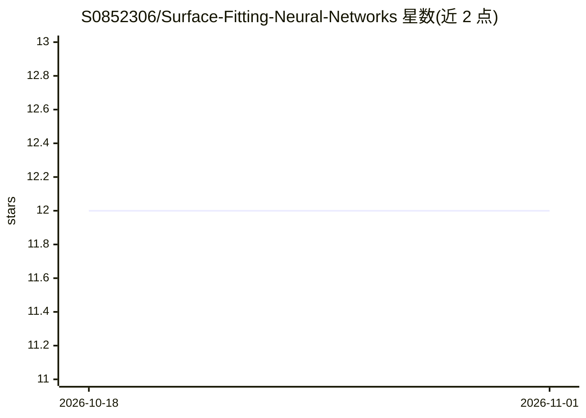

# S0852306/Surface-Fitting-Neural-Networks

⭐ 12 · MATLAB · MIT · 推送 2026-05-20 · [GitHub](https://github.com/S0852306/Surface-Fitting-Neural-Networks) · 个人维护

**纯 MATLAB 实现的 N 维曲面拟合与非线性回归神经网络工具箱**

面向 MATLAB 用户的曲线/曲面拟合与非线性回归工具箱：提供 NeuralFit 入口的简化工作流（默认高斯基）与可自定义架构的完整工作流，支持 7 种激活函数（含可学习 B 样条基）、ANN/ResNet 架构、7 种优化器（SGD 到 BFGS/L-BFGS）及两阶段训练。纯 MATLAB 实现，不依赖 Deep Learning Toolbox、MEX 或外部依赖，通过安装脚本将工具箱加入 MATLAB 路径，附带演示脚本与文档。

## 筛选速览

| 维度 | 判定 | 备注 |
|---|---|---|
| AI 角色 | `ai-native` | 本体是模型或模型工具 |
| 许可风险 | `permissive` | MIT |
| 部署形态 | `None` |  |
| 模型依赖 | — | README 未给出锁定关系 |
| 硬件要求 | — | 无带数字的原话,不猜 |
| 安装摩擦 | `low` | 无编译、无系统依赖或容器化 |
| 成熟度 | — | 结构信号不足 |

## 能力要点

- 可学习 B 样条激活，适配尖锐/振荡/非光滑目标
- 7 种激活与 7 种优化器（含 BFGS/L-BFGS 拟牛顿精修）
- 两阶段训练：随机优化 + 拟牛顿精修提升拟合精度
- 纯 MATLAB 实现零外部依赖

## 适用场景

- 用神经网络做多元非线性回归与函数逼近
- 拟合尖锐或非光滑的实验/仿真数据曲面
- 在无 Deep Learning Toolbox 的 MATLAB 环境中做高精度拟合

## 场景标签

 · 领域:科学计算/机器学习

## 证据(README 行号)

> L3: Lightweight MATLAB toolbox for **N-dimensional curve fitting**, **surface fitting**, **nonlinear regression**, and *
> L7: Pure MATLAB implementation with no Deep Learning Toolbox, MEX, or external dependencies.

## 星数曲线

2026-10-18 12 → 2026-11-01 12（+0）

---
*卡片 v1 · prompt 1.4 · 生成 2026-11-01 · 置信度 high · 依据 README sha `2e95368eede8` · [字段定义](../../DATASET.md)*
