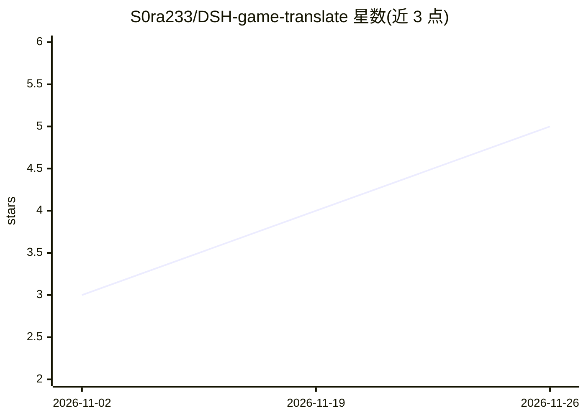

# S0ra233/DSH-game-translate

⭐ 5 · JavaScript · MIT · 推送 2026-10-27 · [GitHub](https://github.com/S0ra233/DSH-game-translate) · 个人维护 · 中文 README

**给 DSH 用户的可视化本地游戏汉化插件，覆盖六类引擎**

基于 DeepSeek Harness (`dsh`) 构建的游戏汉化插件：在 DSH 工作目录输入 `/翻译` 唤出原生翻译窗口，负责目录选择、章节分组阅读、原文/译文双栏对照、检索筛选与单句手改；资产解包、翻译任务派发、审校与独立副本写回由主对话 Agent 协同 game-translation Skill/Core 完成。批量翻译可交由主 Agent 或 DSH 原生子 Agent 委托外部模型并发处理。运行环境限定 Windows x64，需 .NET Framework 4.8、WebView2、Node.js 24.9+、Python 3.10+。

## 筛选速览

| 维度 | 判定 | 备注 |
|---|---|---|
| AI 角色 | `ai-native` | 本体是模型或模型工具 |
| 许可风险 | `permissive` | MIT |
| 部署形态 | `None` |  |
| 模型依赖 | locked-api |  |
| 硬件要求 | — | 无带数字的原话,不猜 |
| 安装摩擦 | `low` | 无编译、无系统依赖或容器化 |
| 成熟度 | — | 结构信号不足 |

## 能力要点

- 六大引擎家族的提取与写回适配：RPG Maker、Unity、Ren'Py、Godot、WOLF、TyranoScript
- 双栏等高对照审校，手改保存走 Core 校验、不调用大模型、零 Token 消耗
- DSH 主/子 Agent 调度，多模型并发派发，兼容四种 API 协议（OpenAI Chat/Responses、Anthropic、Gemini）
- 原游戏保持只读，生成独立汉化副本并逐字段读回核验

## 适用场景

- 汉化 RPG Maker / Ren'Py / Unity 等引擎的游戏文本
- 双栏对照审校 AI 译文并手动微调个别句子
- 在不改动原游戏的前提下生成独立汉化副本

## 场景标签

 · 领域:游戏本地化/翻译工具

## 证据(README 行号)

> L5: **DSH-game-translate** 是基于 DeepSeek Harness (`dsh`) 构建的可视化本地游戏汉化插件。全部插件代码与资源均独立维护于本目录，无需修改上游 `game-translation` 核心或宿
> L7: 在工作目录的根对话中输入 `/翻译` 即可唤出独立的原生翻译窗口：窗口专注于**目录选择、章节分组阅读、双栏对照、检索筛选、任务进度与单句手改微调**；底层的**资产解包、翻译任务派发、质量审校及独立副本写回**则由主对话 Agen
> L12: * **DSH 主/子 Agent 调度（翻译编排与多模型并发）**：主对话 Agent 负责工程初始化、上下文审校与最终封装指令；批量翻译既可由主 Agent 直接完成，也可通过 DSH 原生子 Agent（内置等待机制与防重复

## 星数曲线

2026-11-02 3 → 2026-11-26 5（+2）

---
*卡片 v1 · prompt 1.4 · 生成 2026-11-21 · 置信度 high · 依据 README sha `3ae5ebfecfc3` · [字段定义](../../DATASET.md)*
