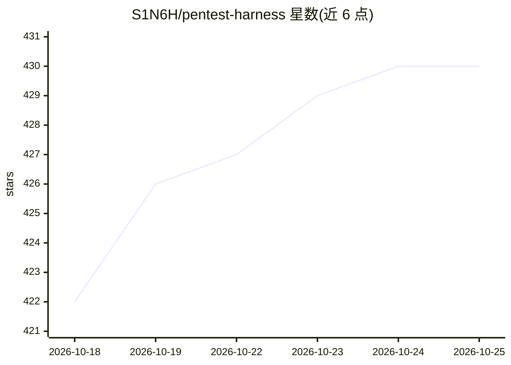

# S1N6H/pentest-harness

⭐ 432 · TypeScript · MIT · 推送 2026-10-07 · [GitHub](https://github.com/S1N6H/pentest-harness) · [官网](https://github.com/S1N6H/pentest-harness) · 个人维护

**自托管 AI agent 工作台：面向授权渗透测试与安全研究**

开源的自托管 AI agent harness，面向授权渗透测试、漏洞赏金研究、安全实验室与 CTF 场景。采用插件架构（基于 Cordis），模型适配器、工具、会话、设置与凭证层均可通过配置替换。支持 OpenAI、Anthropic、DeepSeek 等多种模型 API 及任意 OpenAI 兼容网关，提供一键模型自动发现；会话以 JSONL/SQLite 持久化并可重放，API key 存储于仅属主可读的本地凭证库。通过 git clone 源码安装，需 Node.js 20+ 与 pnpm，构建后本地启动 Web UI。

## 筛选速览

| 维度 | 判定 | 备注 |
|---|---|---|
| AI 角色 | `ai-native` | 本体是模型或模型工具 |
| 许可风险 | `permissive` | MIT |
| 部署形态 | `library` | 以包/库形式分发 |
| 模型依赖 | locked-api |  |
| 硬件要求 | — | 无带数字的原话,不猜 |
| 安装摩擦 | `low` | 无编译、无系统依赖或容器化 |
| 成熟度 | — | 结构信号不足 |

## 能力要点

- 多 provider LLM 引擎：OpenAI Chat Completions/Responses、Anthropic Messages、DeepSeek 及任意 OpenAI 兼容网关，一键模型自动发现
- 完整 agent 工具集：shell、文件系统、web 研究、技能、目标、子 agent、后台任务与工作流控制
- JSONL/SQLite 持久化会话，支持重放与恢复
- API key 存于属主专属凭证库，不写入设置文件或日志

## 适用场景

- 在授权渗透测试或红队项目中让 AI agent 执行安全测试任务
- 漏洞赏金研究与 CTF 竞赛中长期会话的安全工作台
- 自带 API key 在本地运行模型驱动的安全研究环境

## 场景标签

`网络安全` · 领域:学习与行业

## 证据(README 行号)

> L7: An open-source, dark-first AI agent harness for authorized penetration tests, bug bounty
> L12: **Works with any AI model API.** Bring your own key from OpenAI, Anthropic, DeepSeek,

## 星数曲线

2026-10-18 422 → 2026-10-25 430（+8）

---
*卡片 v1 · prompt 1.4 · 生成 2026-10-21 · 置信度 mid · 依据 README sha `d7f6df8eb159` · [字段定义](../../DATASET.md)*
