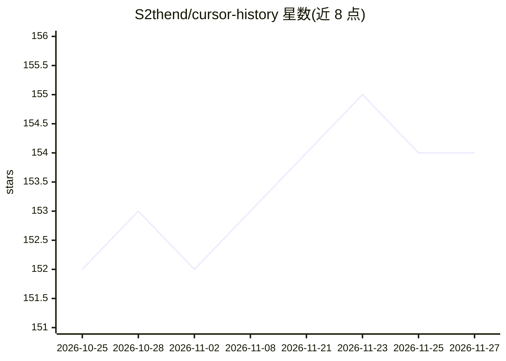

# S2thend/cursor-history

⭐ 154 · TypeScript · MIT · 推送 2026-10-26 · [GitHub](https://github.com/S2thend/cursor-history) · [官网](https://www.npmjs.com/package/cursor-history) · 个人维护

**为 Cursor 用户提供聊天历史的搜索、导出、备份与迁移 CLI**

以 CLI 与 Node.js API 两种形态读取 Cursor 在本地的多种存储来源（Composer 数据库、Agent transcripts、Store/CLI 与 ACP 会话库），提供跨工作区关键词搜索（本地执行，无需嵌入或 API key）、消息与工具调用查看、Markdown/JSON 导出、Composer 数据的备份/恢复与符合条件的会话迁移，另带本地只读 Web UI 与独立的 MCP 服务器包。限制：备份与迁移仅覆盖 Composer 数据，Store/ACP 会话仅可读取导出、不可恢复备份；需 Node.js 20.x 或 22.x–26.x 及已有本地 Cursor 历史。

## 筛选速览

| 维度 | 判定 | 备注 |
|---|---|---|
| AI 角色 | `ai-ecosystem` | LLM/agent 周边工具 |
| 许可风险 | `permissive` | MIT |
| 部署形态 | `library` | 以包/库形式分发 |
| 模型依赖 | — | README 未给出锁定关系 |
| 硬件要求 | — | 无带数字的原话,不猜 |
| 安装摩擦 | `low` | 无编译、无系统依赖或容器化 |
| 成熟度 | — | 结构信号不足 |

## 能力要点

- 统一接口读取四类本地存储源：Composer、Agent transcripts、Store/CLI、ACP
- 跨工作区关键词搜索，本地执行，无需嵌入或 API key
- 导出 messages/ShareGPT/TRL 数据集格式，支持凭证脱敏与会话级 train/val 划分
- CLI + Node.js 库双接口，附本地只读 Web UI 与独立 MCP 服务器包

## 适用场景

- 找回以前在某个项目里解决过问题的那段 Cursor 对话
- 重命名/迁移项目时把 Composer 会话搬到新工作区
- 把积累的 Cursor 编码对话转成微调训练数据集
- 通过 MCP 让 agent 搜索本地开发历史

## 场景标签

 · 领域:开发者工具/AI 编程辅助配套

## 证据(README 行号)

> L3:  cursor-history — One interface for your entire Cursor history. Composer, Agent transcripts, and Store / ACP sources
> L15: Cursor conversations can be spread across workspaces, IDE databases, Agent transcripts, and newer CLI / ACP session
> L124: - **Dual interface** - Use as CLI tool or import as a library in your Node.js projects

## 星数曲线

2026-10-25 152 → 2026-11-27 154（+2）

---
*卡片 v1 · prompt 1.4 · 生成 2026-11-27 · 置信度 high · 依据 README sha `0e1403b9e0e9` · [字段定义](../../DATASET.md)*
