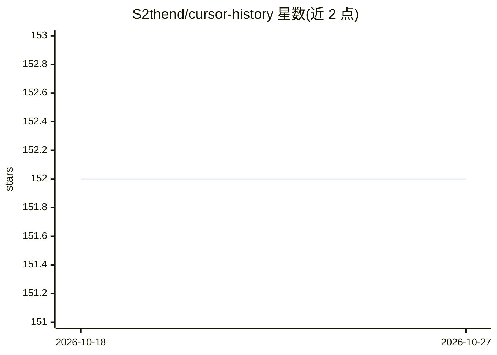

# S2thend/cursor-history

⭐ 152 · TypeScript · MIT · 推送 2026-10-26 · [GitHub](https://github.com/S2thend/cursor-history) · [官网](https://www.npmjs.com/package/cursor-history) · 个人维护 · 中文 README

**浏览/搜索/导出/备份本地 Cursor 聊天历史的 CLI 与 Node.js 库**

面向使用 Cursor IDE 与 Agent CLI 的开发者：自动发现本地多种 Cursor 存储来源（Composer 的 state.vscdb、Agent transcripts、Store/CLI 与 ACP 会话库），统一通过 CLI 和 Node.js API 提供 list/search/show/export 操作，可导出 Markdown 或 JSON。支持 Composer 数据备份与恢复、符合条件的 Composer 会话跨工作区迁移（--dry-run 预览）。搜索本地执行，无需 embeddings 或 API key，无需事先建立索引。备份仅覆盖 Composer 数据库，Store-only 会话不可迁移。通过 npm 安装，需 Node.js 20.x 或 22.x–26.x，提供双 SQLite 驱动自动选择。

## 筛选速览

| 维度 | 判定 | 备注 |
|---|---|---|
| AI 角色 | `ai-enhanced` | 去掉 AI 部分产品仍成立 |
| 许可风险 | `permissive` | MIT |
| 部署形态 | `library` | 以包/库形式分发 |
| 模型依赖 | — | README 未给出锁定关系 |
| 硬件要求 | — | 无带数字的原话,不猜 |
| 安装摩擦 | `low` | 无编译、无系统依赖或容器化 |
| 成熟度 | — | 结构信号不足 |

## 能力要点

- 统一读取 Composer / Agent transcripts / Store / ACP 四类本地来源
- 跨工作区关键词搜索本地会话内容，无需 embeddings 或 API key
- 导出 Markdown/JSON，Composer 备份、恢复与迁移（--dry-run 预览）
- CLI 与 Node.js 库双接口，另有独立 MCP 伴随包

## 适用场景

- 在多工作区历史中找回曾经解决过问题的对话
- 导出或备份 Cursor 会话与 Agent 记录以防丢失
- 项目重命名或搬迁时迁移 Composer 会话
- 通过 Node.js API 或 MCP 让自己的工具复用历史记录

## 场景标签

 · 领域:开发者工具/AI 会话数据管理

## 证据(README 行号)

> L15: Cursor conversations can be spread across workspaces, IDE databases, Agent transcripts, and newer CLI / ACP session
> L17: Search conversation content across workspaces, inspect messages and available tool activity, and export to Markdown
> L113: Use the Node.js library directly, or connect the separate cursor-history-mcp server so an MCP-capable assistant ca

## 星数曲线

2026-10-18 152 → 2026-10-27 152（+0）

---
*卡片 v1 · prompt 1.4 · 生成 2026-10-22 · 置信度 mid · 依据 README sha `19f2c623ab5b` · [字段定义](../../DATASET.md)*
