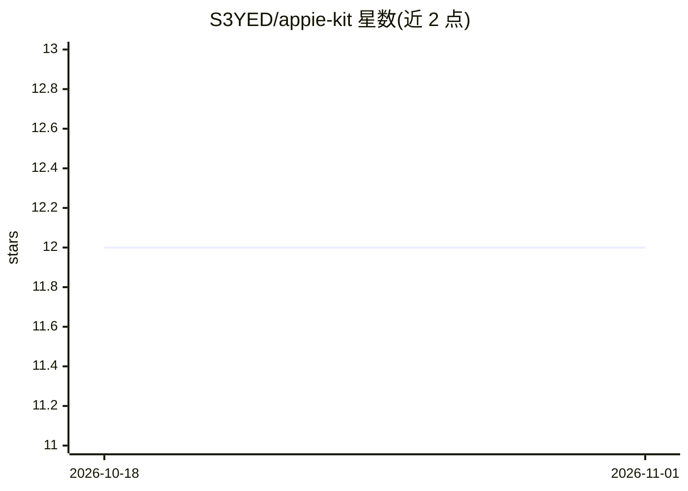

# S3YED/appie-kit

⭐ 12 · Python · MIT · 推送 2026-08-26 · [GitHub](https://github.com/S3YED/appie-kit) · [官网](https://weblyfe.ai) · 个人维护

**AI 员工启动套件：939 个去重 agent 技能+工作区配置与安装脚本**

从 Weblyfe 网页设计代理机构的 7-agent 生产集群中提取的完整启动套件，包含 939 个技能（42 类）、SOUL/USER/TOOLS 工作区文件、install.sh 安装脚本与多 agent 部署配置。面向使用 Hermes Agent 或 OpenClaw 的用户，将技能复制到 ~/.hermes 或 ~/.openclaw 目录运行；默认模型通道为 OpenRouter 的 deepseek-v4-flash，技能兼容 Claude Code、Codex CLI 等 agent 运行时。附案例研究与安全扫描工具。

## 筛选速览

| 维度 | 判定 | 备注 |
|---|---|---|
| AI 角色 | `ai-knowledge` | 知识聚合/清单类 |
| 许可风险 | `permissive` | MIT |
| 部署形态 | `None` |  |
| 模型依赖 | locked-api |  |
| 硬件要求 | — | 无带数字的原话,不猜 |
| 安装摩擦 | `low` | 无编译、无系统依赖或容器化 |
| 成熟度 | — | 结构信号不足 |

## 能力要点

- 939 个生产技能按 42 类组织，含自动化、设计、devops、集成等
- 提供 workspace 身份文件（SOUL.md/USER.md/TOOLS.md）与 install.sh 一键安装
- 技能跨 Hermes Agent、Claude Code、Codex CLI、OpenClaw 多运行时使用
- 附多 agent 舰队配置示例（3 个 AI 员工约 $148/月）

## 适用场景

- 为 Hermes Agent / OpenClaw 搭建全天候自动化 AI 员工
- 复用现成技能实现邮件分诊、CRM 自动化、网站构建等代理机构业务
- 组建多 agent 协作舰队处理编排/营销/运维任务

## 场景标签

`多智能体` `提示工程` · 领域:Agent 开发

## 证据(README 行号)

> L29: - **939 production skills** extracted from the live Appie fleet (Mac Mini, GPU/media workers, VPS nodes, and approv
> L31: - **Multi-agent runtime detection** -- skills now work across Hermes Agent, Claude Code, Codex CLI, and Pi agents.
> L104: 939 production skills across 42 categories. Each category has its own index.

## 星数曲线

2026-10-18 12 → 2026-11-01 12（+0）

---
*卡片 v1 · prompt 1.4 · 生成 2026-11-01 · 置信度 high · 依据 README sha `1e36aa9833b7` · [字段定义](../../DATASET.md)*
