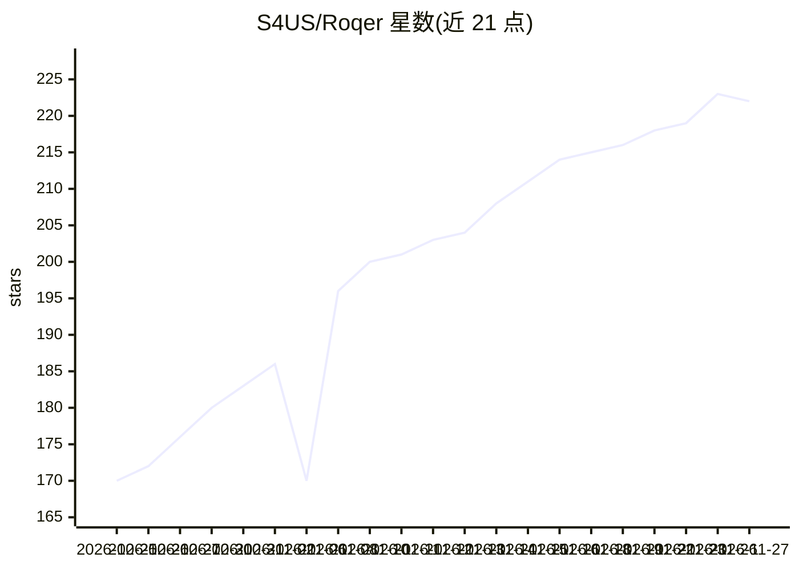

# S4US/Roqer

⭐ 222 · TypeScript · AGPL-3.0 · 推送 2026-11-26 · [GitHub](https://github.com/S4US/Roqer) · 个人维护

**Roblox Studio 的 AI 代理：按指令搭建、写脚本并测试**

面向 Roblox Studio 创作者的桌面端 AI 代理：读取并编辑场景实例、属性与脚本，运行单人/多客户端 playtest、读取输出、截图并分析性能；可选 Blender 建模集成与图像生成（贴图/UI 图标）；支持 Rojo 项目同步到 git。模型接入方式为复用用户已有的 ChatGPT（Codex）、Claude（Claude Code）、Gemini CLI 或任意 OpenAI/Anthropic 兼容端点，本地运行、无需 Roqer 账号。需 Windows（或 Linux+Vinegar）与 Node.js 20，从源码构建。

## 筛选速览

| 维度 | 判定 | 备注 |
|---|---|---|
| AI 角色 | `ai-native` | 本体是模型或模型工具 |
| 许可风险 | `viral` | AGPL-3.0 |
| 部署形态 | `library` | 以包/库形式分发 |
| 模型依赖 | locked-api |  |
| 硬件要求 | — | 无带数字的原话,不猜 |
| 安装摩擦 | `low` | 无编译、无系统依赖或容器化 |
| 成熟度 | — | 结构信号不足 |

## 能力要点

- 在用户自己的 Roblox 场景中读写实例、属性、脚本并自动 playtest
- 可选 Blender 集成建模、预览渲染并上传到场景
- 支持 ChatGPT/Claude/Gemini 订阅及任意 OpenAI/Anthropic 兼容端点（含本地模型）
- Studio 工具可作为独立 MCP 服务器供 Claude Code/Codex/Cursor 等客户端调用

## 适用场景

- 用自然语言让代理在 Roblox 场景里搭建地图、模型并编写 Luau 脚本
- 生成粒子贴图、UI 图标与角色动画并自动测试
- 将 Studio 工具接入自己的 MCP 客户端工作流

## 场景标签

`编码 Agent` `图像生成` · 领域:编码与开发

## 证据(README 行号)

> L5:  An open-source AI agent for Roblox Studio.
> L28: - **Your own model.** ChatGPT through the Codex app, Claude through Claude Code, Gemini through the Antigravity CLI

## 星数曲线

2026-10-25 170 → 2026-11-27 222（+52）

---
*卡片 v1 · prompt 1.4 · 生成 2026-11-25 · 置信度 high · 依据 README sha `502609a8ada7` · [字段定义](../../DATASET.md)*
