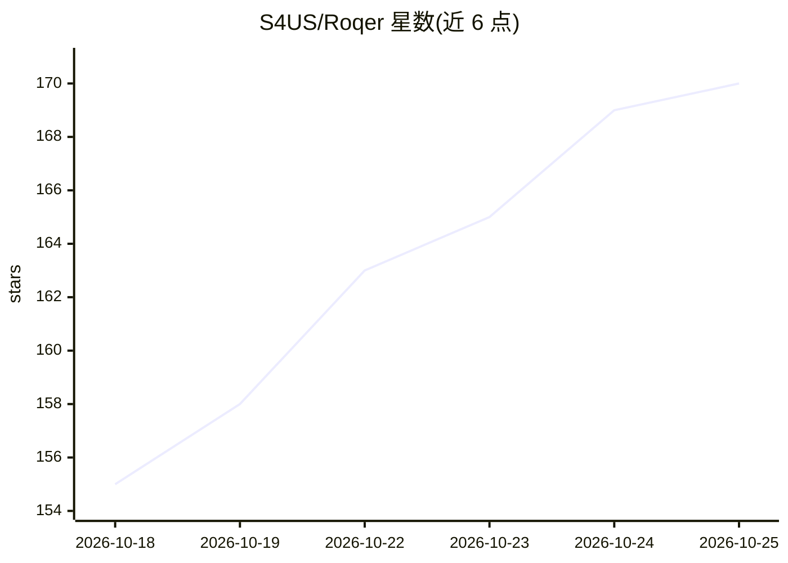

# S4US/Roqer

⭐ 170 · TypeScript · AGPL-3.0 · 推送 2026-10-23 · [GitHub](https://github.com/S4US/Roqer) · 组织维护

**Roblox Studio 开源 AI agent：按自然语言指令搭建、编写脚本并试玩**

面向 Roblox 开发者的开源 AI agent 桌面应用（Electron）。用户用自然语言下达需求，agent 在自己的 place 中读取与编辑实例、属性和脚本，编写 Luau 脚本，生成 R15 角色动画，可选集成 Blender 建模并上传；可运行单人/多客户端试玩、读服务器与客户端输出、截图并做性能分析。模型由用户自带：ChatGPT（Codex app）、Claude（Claude Code）、Gemini（Antigravity CLI）或任意 OpenAI/Anthropic 兼容端点（含本地模型）。本地运行，无账号/服务器；需 Windows + Roblox Studio + Node.js 20+，从源码构建运行。Studio 工具也可作为独立 MCP 服务器供其他 AI 客户端使用。AGPL-3.0-or-later。

## 筛选速览

| 维度 | 判定 | 备注 |
|---|---|---|
| AI 角色 | `ai-native` | 本体是模型或模型工具 |
| 许可风险 | `viral` | AGPL-3.0 |
| 部署形态 | `library` | 以包/库形式分发 |
| 模型依赖 | locked-api |  |
| 硬件要求 | — | 无带数字的原话,不猜 |
| 安装摩擦 | `low` | 无编译、无系统依赖或容器化 |
| 成熟度 | — | 结构信号不足 |

## 能力要点

- 自然语言驱动：在 Roblox Studio 中搭建、写脚本、生成动画并自动试玩
- 支持任意 OpenAI/Anthropic 兼容端点，含本地模型；对话直连用户所选模型商
- Studio 工具打包为独立 MCP 服务器，可被 Claude Code/Codex/Cursor 等客户端复用
- 可选 Blender 建模集成与 Rojo 项目同步（脚本改动进 git diff）

## 适用场景

- 让 AI 在我的 Roblox place 里实现武器、特效等玩法并自动试玩验证
- 用自己的 ChatGPT/Claude 订阅驱动 Studio 内的构建工作流
- 在 Claude Code/Cursor 等已有 AI 客户端中直接操作 Roblox Studio 工具

## 场景标签

`编码 Agent` · 领域:编码与开发

## 证据(README 行号)

> L5:  An open-source AI agent for Roblox Studio.
> L6:  Tell it what you want, and it builds, scripts, and playtests it in your place,
> L28: - **Your own model.** ChatGPT through the Codex app, Claude through Claude Code, Gemini through the Antigravity CLI
> L32: - **Tests its own work.** Runs solo and multi-client playtests, reads server and client output, takes screenshots, 

## 星数曲线

2026-10-18 155 → 2026-10-25 170（+15）

---
*卡片 v1 · prompt 1.4 · 生成 2026-10-22 · 置信度 high · 依据 README sha `5f0918d7ee42` · [字段定义](../../DATASET.md)*
