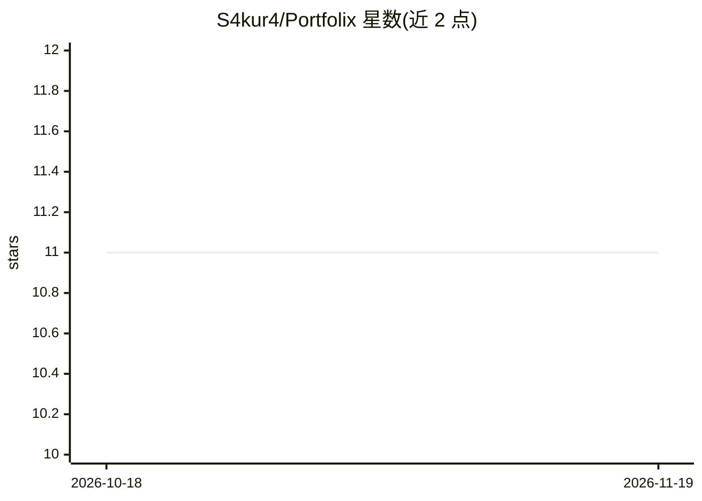

# S4kur4/Portfolix

⭐ 11 · Swift · Apache-2.0 · 推送 2026-11-11 · [GitHub](https://github.com/S4kur4/Portfolix) · 个人维护 · 中文 README

**本地优先的 macOS 持仓记账工具，AI 分析按需启用**

一款原生 macOS 资产记账应用，记录多类资产的添加、增持、卖出与现金变化，提供组合价值、盈亏日历、收益趋势与持仓占比跟踪；支持股票、基金、数字货币的公开行情自动刷新。数据默认保存在本机并可导出备份，不连接券商账户、不执行交易。AI 为可选功能：用自有 DeepSeek API Key 生成报告与分析，支持联网增强搜索；另提供只读 MCP 接口授权本机 Agent 查询持仓数据。基础记账无需配置 AI。

## 筛选速览

| 维度 | 判定 | 备注 |
|---|---|---|
| AI 角色 | `ai-enhanced` | 去掉 AI 部分产品仍成立 |
| 许可风险 | `permissive` | Apache-2.0 |
| 部署形态 | `None` |  |
| 模型依赖 | locked-api |  |
| 硬件要求 | — | 无带数字的原话,不猜 |
| 安装摩擦 | `low` | 无编译、无系统依赖或容器化 |
| 成熟度 | — | 结构信号不足 |

## 能力要点

- 记录 A 股、B 股、美股、港股、公募基金、数字货币和现金
- 股票/基金/数字货币公开行情自动刷新，无需行情 API Key
- 本机语音输入资产信息
- 只读 MCP 接口授权本机 Agent 查询持仓与收益记录

## 适用场景

- 手工记录多市场持仓并跟踪收益变化
- 不连接券商的情况下本地管理个人资产账本
- 用自有 API Key 按需生成投资分析报告
- 让本地 Agent 只读查询持仓与操作记录

## 场景标签

`金融量化` · 领域:学习与行业

## 证据(README 行号)

> L36: 基础记账与收益跟踪无需配置 AI。
> L38: - **AI 辅助分析**：使用自己的 DeepSeek API Key 生成报告、提问或分析资产的实际投资领域。联网增强可按需启用 Parallel Search、DeepSeek Search、Tavily、博查、Exa 或 
> L39: - **只读 MCP**：授权本机 Agent 查询持仓、收益和操作记录，支持 ChatGPT / Codex、Claude、DeepSeek Harness、WorkBuddy；客户端配置可在 App 中查看。

## 星数曲线

2026-10-18 11 → 2026-11-19 11（+0）

---
*卡片 v1 · prompt 1.4 · 生成 2026-11-18 · 置信度 high · 依据 README sha `913a5f5a304c` · [字段定义](../../DATASET.md)*
