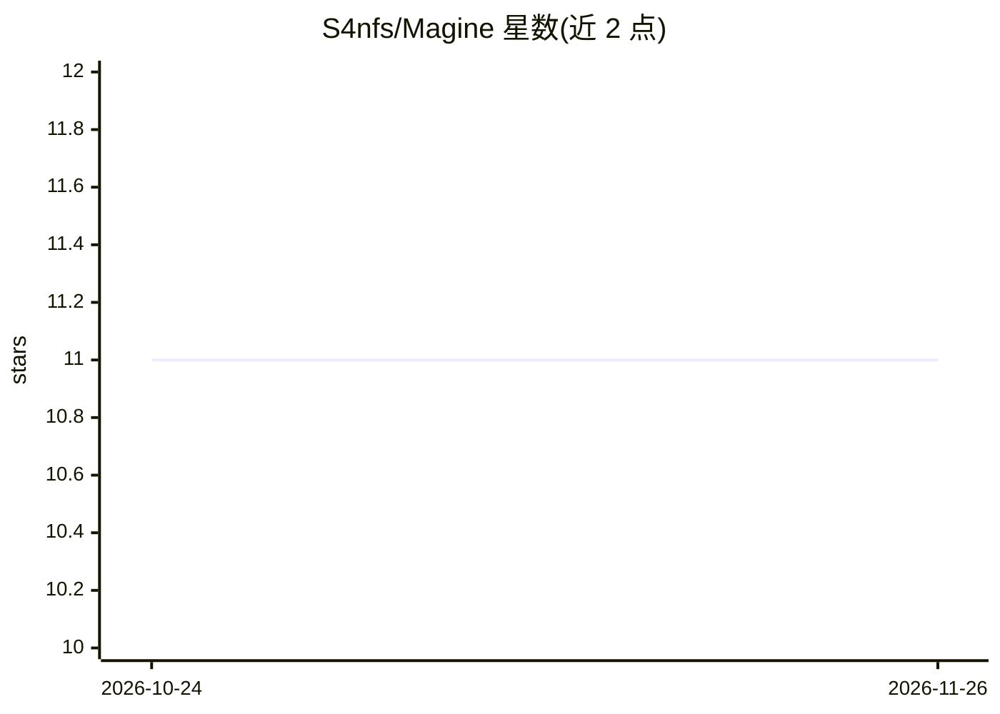

# S4nfs/Magine

⭐ 11 · 推送 2026-09-06 · [GitHub](https://github.com/S4nfs/Magine) · [官网](https://magine.cloud) · 个人维护

**为终端用户提供视觉驱动自主浏览网页的 AI agent 平台**

终端风格 Web 界面的 AI 编排平台，核心是 Sight-Driven Agents（SDA）：截取页面实时帧交给自研视觉模型 Hayai，按屏幕坐标规划并执行点击/输入等 GUI 操作，提供 classic、cdp、agp 三种驱动工作流，agp 完全不依赖 DOM。支持自然语言定时调度、页面变化触发的 Heartbeat 模式、实时画面查看与逐帧回放、Human/Machine 双模式界面，以及 GitHub 主页分析与分享卡片生成；浏览器扩展为可选的登录会话同步组件，agent 运行在独立沙箱云浏览器中。

## 筛选速览

| 维度 | 判定 | 备注 |
|---|---|---|
| AI 角色 | `ai-native` | 本体是模型或模型工具 |
| 许可风险 | `none` | — |
| 部署形态 | `library` | 以包/库形式分发 |
| 模型依赖 | — | README 未给出锁定关系 |
| 硬件要求 | — | 无带数字的原话,不猜 |
| 安装摩擦 | `low` | 无编译、无系统依赖或容器化 |
| 成熟度 | — | 结构信号不足 |

## 能力要点

- AGP 工作流：帧捕获→Hayai 视觉模型定位控件→屏幕坐标执行，不依赖选择器与标记
- 三种页面驱动方式（classic/cdp/agp）按 agent 可切换，检测不确定时回退 OCR
- 自然语言调度与页面变化触发的 Heartbeat 响应式 agent
- 运行记录逐帧回放，短期与跨运行的长期记忆

## 适用场景

- 让 agent 自动处理 Gmail 收件箱分类等网页任务
- 定时或页面变化时自动执行信息抓取与发帖
- 输入 GitHub 用户名生成开发者主页分析与分享卡片
- 对 canvas 应用等 DOM 方式失效的页面做自动化

## 场景标签

`浏览器自动化` · 领域:效率与自动化

## 证据(README 行号)

> L21: **Magine** is a retro-terminal web interface for deep GitHub profile analysis, AI-powered browser automation, and s
> L45: **Magine** was born to fix this. Instead of teaching agents to parse HTML, we built **Sight-Driven Agents (SDAs)** 

## 星数曲线

2026-10-24 11 → 2026-11-26 11（+0）

---
*卡片 v1 · prompt 1.4 · 生成 2026-11-18 · 置信度 mid · 依据 README sha `308180407634` · [字段定义](../../DATASET.md)*
