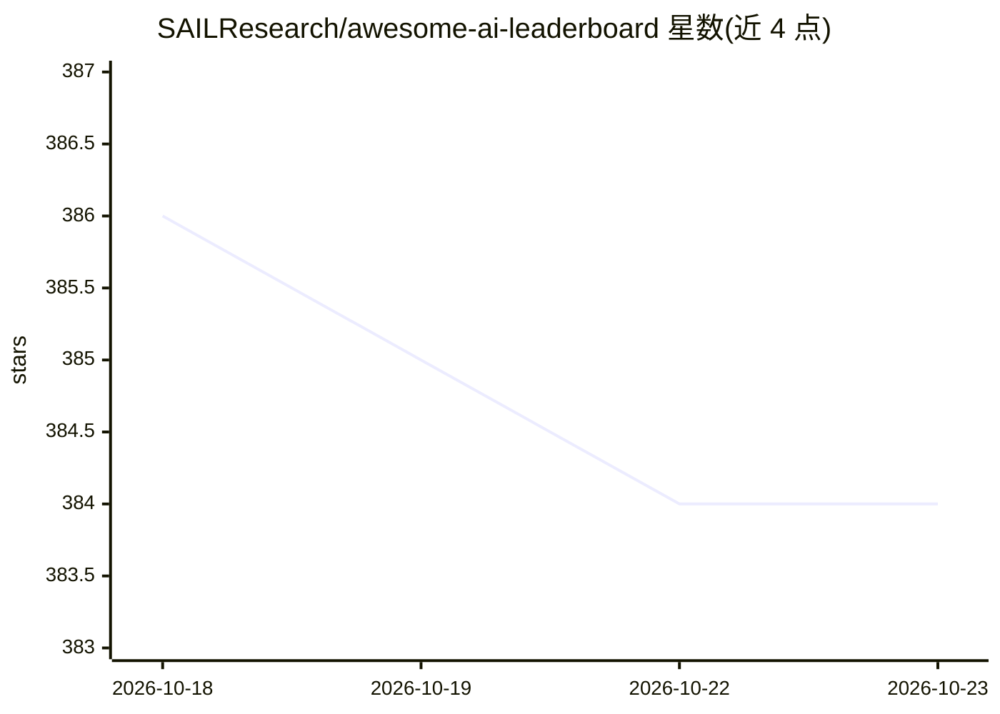

# SAILResearch/awesome-ai-leaderboard

⭐ 384 · 推送 2026-10-22 · [GitHub](https://github.com/SAILResearch/awesome-ai-leaderboard) · [官网](https://sailresearch.github.io/awesome-ai-leaderboard/) · 组织维护

**AI 榜单资源策展清单：收录排行榜、工具与评测组织**

由 SAIL（Software Analysis and Intelligence Lab）基于其 LBOps 学术调研维护的 awesome 类清单，汇集 AI 领域的 leaderboard 资源：开发工具（榜单后端、评测结果托管、竞赛创建）、挑战平台（Kaggle、AIcrowd、EvalAI 等）以及按综合/文本等类别组织的模型排行与评测榜单（Arena、HELM、SuperCLUE 等）。条目以表格形式给出名称与一句话描述，收录标准为积极维护且与 AI 相关。仓库本身不含代码，配套论文发表于 arXiv。

## 筛选速览

| 维度 | 判定 | 备注 |
|---|---|---|
| AI 角色 | `ai-knowledge` | 知识聚合/清单类 |
| 许可风险 | `none` | — |
| 部署形态 | `None` |  |
| 模型依赖 | — | README 未给出锁定关系 |
| 硬件要求 | — | 无带数字的原话,不猜 |
| 安装摩擦 | `low` | 无编译、无系统依赖或容器化 |
| 成熟度 | — | 结构信号不足 |

## 能力要点

- 按 Tools / Challenges / Rankings 分类组织榜单资源
- 配套 LBOps 学术调研论文（arXiv 2407.04065）
- 收录标准要求榜单积极维护且与 AI 相关
- 覆盖综合、文本等多类别模型排行与评测榜单

## 适用场景

- 寻找可用的 AI 模型评测榜单与基准
- 了解榜单运维相关的开发工具与挑战平台
- 为学术调研引用 LBOps 论文与配套清单

## 场景标签

`精选清单` · 领域:学习与行业

## 证据(README 行号)

> L13: **Awesome AI Leaderboard** is a curated list of awesome AI leaderboards, along with various development tools and e
> L15:  On the Workflows and Smells of Leaderboard Operations (LBOps): An Exploratory Study of Foundation Model Leaderboar

## 星数曲线

2026-10-18 386 → 2026-10-23 384（-2）

---
*卡片 v1 · prompt 1.4 · 生成 2026-10-21 · 置信度 high · 依据 README sha `bb7c5fe8046a` · [字段定义](../../DATASET.md)*
