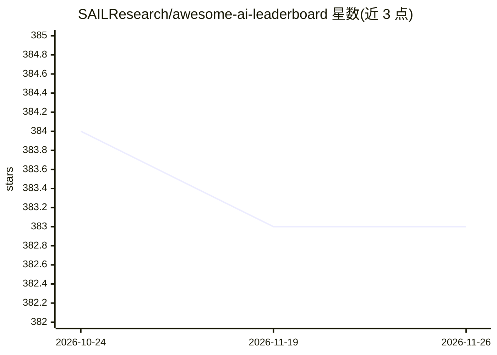

# SAILResearch/awesome-ai-leaderboard

⭐ 383 · 推送 2026-11-25 · [GitHub](https://github.com/SAILResearch/awesome-ai-leaderboard) · [官网](https://sailresearch.github.io/awesome-ai-leaderboard/) · 组织维护 · 中文 README

**AI 排行榜与基准评测资源的策展清单**

由 Software Analysis and Intelligence Lab (SAIL) 维护的 awesome list，收录 AI 领域的排行榜、开发工具与评测组织，并按 Tools、Challenges、Rankings（综合/文本等）分类组织；收录标准为活跃维护且与 AI 相关（L34-37）。条目附一句话功能描述，覆盖基准数据检索、竞赛平台、agent 排名、中文模型评测等。清单源自其 LBOps 探索性研究论文（arXiv:2407.04065），本体为编目列表，不提供可运行代码，接受 PR 与 issue 贡献。

## 筛选速览

| 维度 | 判定 | 备注 |
|---|---|---|
| AI 角色 | `ai-knowledge` | 知识聚合/清单类 |
| 许可风险 | `none` | — |
| 部署形态 | `None` |  |
| 模型依赖 | — | README 未给出锁定关系 |
| 硬件要求 | — | 无带数字的原话,不猜 |
| 安装摩擦 | `low` | 无编译、无系统依赖或容器化 |
| 成熟度 | — | 结构信号不足 |

## 能力要点

- 按 Tools / Challenges / Rankings 等分类收录 AI 排行榜资源
- 收录标准：活跃维护且与 AI 相关
- 配套 LBOps 探索性研究论文（arXiv 链接）
- 开放 PR 与 issue 贡献

## 适用场景

- 寻找某领域（文本、agent、中文模型等）的模型评测排行榜
- 查找可托管模型评测结果的工具与后端
- 调研排行榜运营（LBOps）的背景资料

## 场景标签

`模型评测` `精选清单` · 领域:评测与运维

## 证据(README 行号)

> L13: **Awesome AI Leaderboard** is a curated list of awesome AI leaderboards, along with various development tools and e
> L34: Also, a leaderboard should be included if only:
> L39: ## Table of Contents

## 星数曲线

2026-10-24 384 → 2026-11-26 383（-1）

---
*卡片 v1 · prompt 1.4 · 生成 2026-11-25 · 置信度 high · 依据 README sha `dd9a718f76ab` · [字段定义](../../DATASET.md)*
