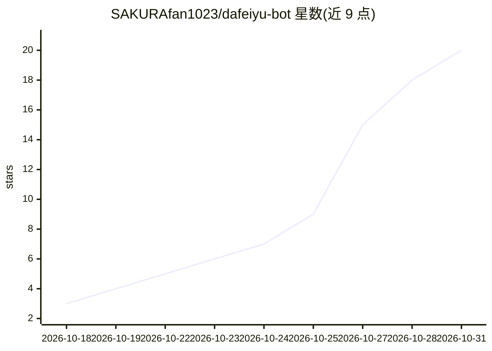

# SAKURAfan1023/dafeiyu-bot

⭐ 20 · Swift · MIT · 推送 2026-10-28 · [GitHub](https://github.com/SAKURAfan1023/dafeiyu-bot) · [官网](https://photos.lifanhu.me/) · 个人维护 · 中文 README

**DeepSeek 驱动的 QQ AI 陪聊与小红书浏览角色**

运行在 macOS（SwiftUI 原生）或 Windows WSL2（本机 Web 面板）的 AI 角色机器人：通过 NapCat/OneBot 11 接入 QQ，以十种内置或自定义人格自动回复私聊与群 @，具备按好友/群分离的记忆、引用还原、识图、智谱生图、搜图与定时分享；另可携带人设登录小红书账号搜帖、读帖并生成评论草稿。限制：微信适配仍在测试，小红书发送未完全验收，无 Windows 原生安装包，需自备 DeepSeek API Key 并从源码构建。

## 筛选速览

| 维度 | 判定 | 备注 |
|---|---|---|
| AI 角色 | `ai-native` | 本体是模型或模型工具 |
| 许可风险 | `permissive` | MIT |
| 部署形态 | `None` |  |
| 模型依赖 | locked-api |  |
| 硬件要求 | — | 无带数字的原话,不猜 |
| 安装摩擦 | `low` | 无编译、无系统依赖或容器化 |
| 成熟度 | `idea` | |

## 能力要点

- QQ 私聊/群 @ 自动回复，按好友/群独立人格与记忆
- 小红书角色：带人设搜帖读帖、生成评论草稿或有限自动参与
- 识图、智谱生图+Cloudflare 备用、Pixiv 搜图命令与定时分享
- macOS SwiftUI 客户端与本机 Web 面板双形态

## 适用场景

- 在 QQ 群/私聊里养一只有性格和记忆的 AI 陪聊角色
- 让 AI 以设定人设浏览小红书话题并准备评论草稿
- 用表情包配图、生图和搜图丰富群聊互动

## 场景标签

`聊天机器人` `图像生成` · 领域:对话与助手

## 证据(README 行号)

> L11: 大肥鱼是一个独立、非官方的成年蓝色鲸鱼娘 AI 角色，脑袋里装着 **DeepSeek**，性格由你来养。她可以是群里的嘴欠搭子，也可以是温柔陪聊的朋友；如今还多了一扇通往小红书的门。
> L13: 在 **QQ**，她用短句和表情包接话，认主人、看引用、记住各自聊过的事，也能帮你搜图、生图、分享插画。在 **小红书**，你给她一个人设和想逛的话题，她就能在绑定的账号下搜笔记、读文字和已加载评论，决定要不要加入讨论。两边各过各

## 星数曲线

2026-10-18 3 → 2026-10-31 20（+17）

---
*卡片 v1 · prompt 1.4 · 生成 2026-10-29 · 置信度 high · 依据 README sha `78a44d981f0b` · [字段定义](../../DATASET.md)*
