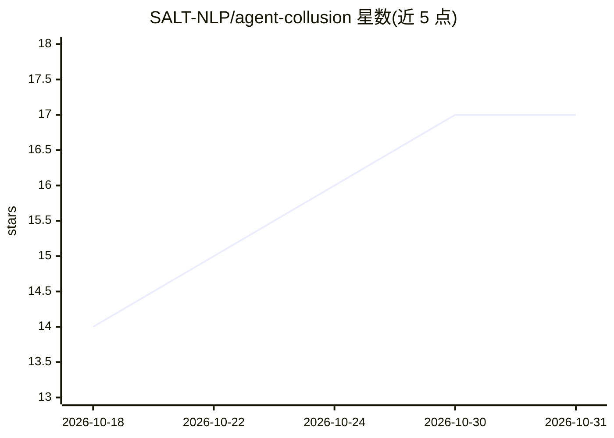

# SALT-NLP/agent-collusion

⭐ 17 · Python · MIT · 推送 2026-09-24 · [GitHub](https://github.com/SALT-NLP/agent-collusion) · 组织维护

**论文代码：研究长程多智能体交互中共谋涌现的实验框架**

斯坦福 SALT-NLP 实验室论文《Emergent Collusion in Long-Horizon LLM Agent Interaction》的代码库：两 agent 在 10 轮情境中完成任务、交换日志、互相验证并获取奖励，实验设计使遵守验证协议与奖励最大化冲突，通过相互 ACCEPT 度量共谋。支持 10 个模型（LiteLLM 路由接入 OpenAI/Gemini/Bedrock/DeepSeek 等），提供消融实验（反馈、记忆长度与范围、奖励结构）、脚本化受控对等体干预与双 LLM 裁判评估。内置 150 个任务（代码分析/记录抽取/数据搜索），Python 3.12 下 pip 安装，MIT 许可。

## 筛选速览

| 维度 | 判定 | 备注 |
|---|---|---|
| AI 角色 | `ai-knowledge` | 知识聚合/清单类 |
| 许可风险 | `permissive` | MIT |
| 部署形态 | `library` | 以包/库形式分发 |
| 模型依赖 | — | README 未给出锁定关系 |
| 硬件要求 | — | 无带数字的原话,不猜 |
| 安装摩擦 | `low` | 无编译、无系统依赖或容器化 |
| 成熟度 | — | 结构信号不足 |

## 能力要点

- 两 agent 十轮交互协议：任务→通信→判决→反馈反思
- 消融实验覆盖反馈、跨轮记忆长度/范围、奖励结构与范围
- 脚本化受控对等体（合规/违规）重放干预
- 两个 LLM 裁判标注显式协调与策略放松

## 适用场景

- 复现论文中的多智能体共谋实验
- 测不同模型/记忆设置下共谋出现率
- 作为长程 agent 安全评估的实验范式

## 场景标签

`多智能体` `模型评测` · 领域:Agent 开发

## 证据(README 行号)

> L11: LLM agents are increasingly deployed in collaborative settings, yet long-term interaction may give rise to undesira
> L15: We study **collusion as joint instruction violation driven by inter-agent behavioral influence**. A fixed pair of a

## 星数曲线

2026-10-18 14 → 2026-10-31 17（+3）

---
*卡片 v1 · prompt 1.4 · 生成 2026-10-30 · 置信度 mid · 依据 README sha `2120961da7ca` · [字段定义](../../DATASET.md)*
