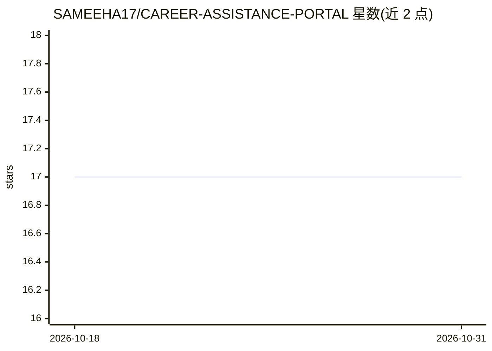

# SAMEEHA17/CAREER-ASSISTANCE-PORTAL

⭐ 17 · JavaScript · 推送 2025-11-27 · [GitHub](https://github.com/SAMEEHA17/CAREER-ASSISTANCE-PORTAL) · [官网](https://sensai-bysamee.vercel.app) · 个人维护

**基于 AI 与行业动态洞察的求职辅助门户（Next.js 全栈）**

Next.js 全栈项目，README 主体为 create-next-app 生成的脚手架文档，仅说明开发服务器启动方式、页面编辑与 Vercel 部署。项目实际功能依据描述：AI 职业指导、简历与求职信生成、模拟面试、热门技能与薪资趋势，技术栈含 Neon DB、Prisma、Inngest、Clerk 认证、Tailwind/Shadcn UI 与 Gemini API。环境变量要求 DATABASE_URL、Clerk 密钥组与 GEMINI_API_KEY。README 未描述具体功能细节与用法，属脚手架阶段文档。

## 筛选速览

| 维度 | 判定 | 备注 |
|---|---|---|
| AI 角色 | `ai-native` | 本体是模型或模型工具 |
| 许可风险 | `none` | — |
| 部署形态 | `None` |  |
| 模型依赖 | — | README 未给出锁定关系 |
| 硬件要求 | — | 无带数字的原话,不猜 |
| 安装摩擦 | `low` | 无编译、无系统依赖或容器化 |
| 成熟度 | — | 结构信号不足 |

## 能力要点

- Gemini API 密钥接入（GEMINI_API_KEY 环境变量）
- Clerk 认证集成（含登录/注册/引导页跳转配置）
- Next.js + Prisma + Neon DB 技术栈，支持 Vercel 部署

## 适用场景

- 求职者生成简历与求职信
- 进行 AI 模拟面试练习
- 查看行业热门技能与薪资趋势

## 场景标签

`AI 写作` · 领域:内容生成

## 证据(README 行号)

> L48: GEMINI_API_KEY=

## 星数曲线

2026-10-18 17 → 2026-10-31 17（+0）

---
*卡片 v1 · prompt 1.4 · 生成 2026-10-30 · 置信度 low · 依据 README sha `1238131f1a78` · [字段定义](../../DATASET.md)*
