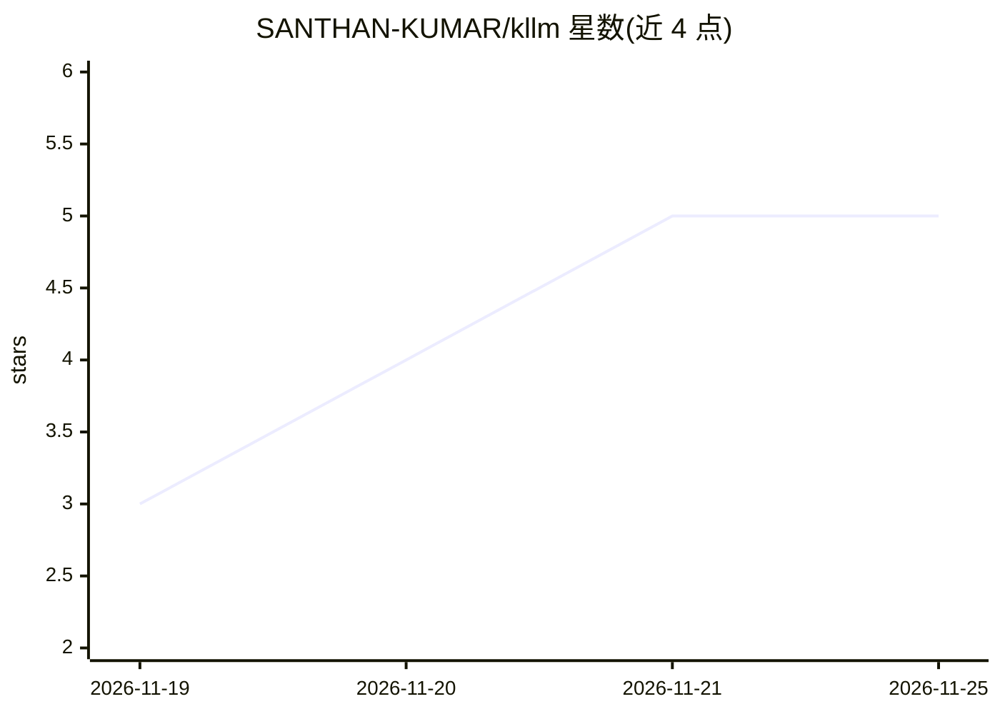

# SANTHAN-KUMAR/kllm

⭐ 5 · Python · MIT · 推送 2026-11-19 · [GitHub](https://github.com/SANTHAN-KUMAR/kllm) · [官网](https://santhan-kumar.github.io/kllm/) · 个人维护

**让编码工具用 Kaggle 免费 GPU 跑开源大模型的本地 API 中继**

kllm 在 Kaggle 免费 Tesla T4 GPU 上通过 llama.cpp 运行 Qwen 等 GGUF 开源模型，并在本机 127.0.0.1 提供 OpenAI 与 Anthropic 兼容端点。本机只保留约 55 MB 的 Python 中继进程，工具经它访问 GPU；支持会话保持在同一 GPU 以复用提示缓存、在 Kaggle 12 小时限制前自动交接新 notebook、空闲 GPU 自动停止。需已验证手机号的 Kaggle 账号（约每周 30 GPU 小时），首次冷启动约 8–10 分钟，超过约 30 GB 权重+缓存的模型无法运行。

## 筛选速览

| 维度 | 判定 | 备注 |
|---|---|---|
| AI 角色 | `ai-ecosystem` | LLM/agent 周边工具 |
| 许可风险 | `permissive` | MIT |
| 部署形态 | `library` | 以包/库形式分发 |
| 模型依赖 | local-ok | 支持本地模型 |
| 硬件要求 | — | 无带数字的原话,不猜 |
| 安装摩擦 | `low` | 无编译、无系统依赖或容器化 |
| 成熟度 | — | 结构信号不足 |

## 能力要点

- 本机 127.0.0.1 提供 OpenAI 与 Anthropic 兼容 API，无需本地 GPU
- 在 Kaggle 双 T4 上经 llama.cpp 运行 GGUF 模型，面板列出 46 个模型并可添加任意 Hugging Face GGUF 仓库
- 12 小时限制前自动启动后继 notebook 并预热缓存交接会话
- 同一管道支持 SDXL Turbo、LTX-Video 等图像视频模型（OpenAI Images API）

## 适用场景

- 无 GPU 笔记本上让 Claude Code 对接 35B 开源模型做代码重构
- 为 opencode、Cursor 等编码工具接入本地 OpenAI 兼容端点
- 不产生 API 账单地跑长上下文编码代理会话

## 场景标签

`模型网关` `推理引擎` · 领域:Agent 开发

## 证据(README 行号)

> L12: **kllm runs open-weight LLMs on Kaggle's free GPUs and gives your coding tools a local API for them.**
> L118: The relay speaks both the OpenAI and the Anthropic API at `http://127.0.0.1:8080`. Requests from your own
> L179: **How is this different from Ollama or LM Studio?** Those run models on your own hardware. kllm runs them on

## 星数曲线

2026-11-19 3 → 2026-11-25 5（+2）

---
*卡片 v1 · prompt 1.4 · 生成 2026-11-21 · 置信度 high · 依据 README sha `7fd8fe463edc` · [字段定义](../../DATASET.md)*
