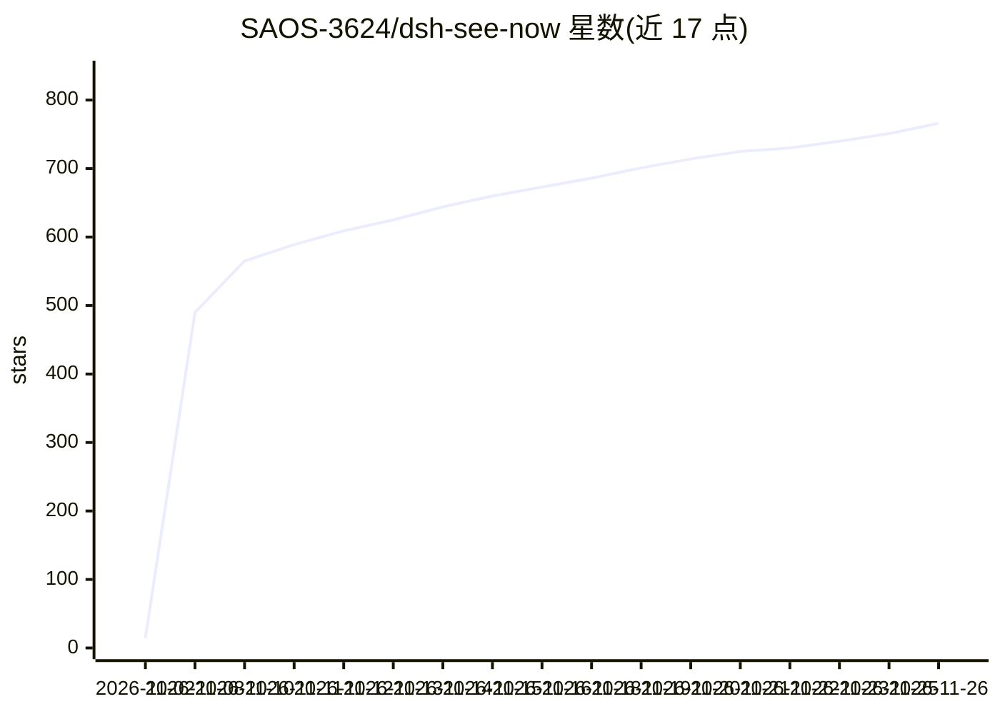

# SAOS-3624/dsh-see-now

⭐ 766 · JavaScript · Apache-2.0 · 推送 2026-11-25 · [GitHub](https://github.com/SAOS-3624/dsh-see-now) · 个人维护 · 中文 README

**DSH 实时视觉插件：按变化量筛帧拼图，让 AI 低成本看屏幕**

面向 DSH（DeepSeek 宿主）的实时屏幕/摄像头/视频视觉插件：对每帧计算 0–255 变化分（HSV 加权差，约 0.2ms），只在切镜或运动量攒够时留帧，多帧拼入一张图（默认 low 档每张 222 token），静止画面仅每 20 秒出一帧兜底。附带悬浮窗展示、`/seenow` 斜杠命令、视频音轨抓取与转写（宿主 SenseVoice 或 OpenAI 兼容服务）、可插拔 TTS 适配器。也提供独立 Node 库导出 capture/pipeline/png。支持 Windows/macOS/Linux 三平台采集引擎，Linux 走 xdg-desktop-portal/PipeWire。

## 筛选速览

| 维度 | 判定 | 备注 |
|---|---|---|
| AI 角色 | `ai-ecosystem` | LLM/agent 周边工具 |
| 许可风险 | `permissive` | Apache-2.0 |
| 部署形态 | `desktop` | 安装包/桌面程序 |
| 模型依赖 | — | README 未给出锁定关系 |
| 硬件要求 | — | 无带数字的原话,不猜 |
| 安装摩擦 | `medium` | 含编译或系统依赖之一 |
| 成熟度 | — | 结构信号不足 |

## 能力要点

- 变化分筛帧 + 多帧拼一张图，默认档每张 222 token
- 三平台屏幕采集：ddagrab/avfoundation/portal-PipeWire
- 视频音轨抓取（WASAPI 进程回环）+ 转写，台词与帧时间码对齐
- TTS 适配器动态加载，配置指纹变更自动重挂，改完即生效

## 适用场景

- 让 AI 陪看屏幕/视频并低 token 成本持续理解画面
- 把实时视觉能力接入 DSH agent 会话
- 作为 Node 库复用帧采集与筛选管线

## 场景标签

`语音识别` `语音合成` · 领域:内容生成

## 证据(README 行号)

> L5: 一个给 DSH 用的实时视觉插件：把你的屏幕（或摄像头 / 视频文件）变成一串**按变化量筛选过**的画面，压进一张几帧拼成的图，交给模型。
> L141: 已经发布到 npm，用 DSH 自带的 `dsh plugin` 装（它本质是 profile 维度的 pnpm 包装器 +

## 星数曲线

2026-11-02 15 → 2026-11-26 766（+751）

---
*卡片 v1 · prompt 1.4 · 生成 2026-11-17 · 置信度 mid · 依据 README sha `4d90b11c9b62` · [字段定义](../../DATASET.md)*
