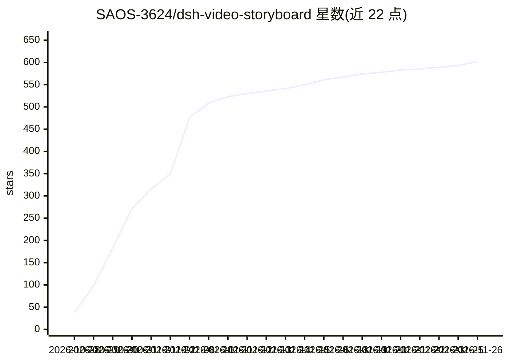

# SAOS-3624/dsh-video-storyboard

⭐ 602 · JavaScript · Apache-2.0 · 推送 2026-11-25 · [GitHub](https://github.com/SAOS-3624/dsh-video-storyboard) · [官网](https://github.com/SAOS-3624/dsh-video-storyboard) · 个人维护 · 中文 README

**DSH 插件：把视频压成宫格分镜图与带时间码清单供模型阅读**

DeepSeek Harness（DSH）的视频理解插件，提供 7 个工具：将视频按镜头切点压缩成一张宫格图（默认约 222-233 token）并生成时间对齐的文本清单，支持按切点密度分配格子大小（8 档）、video_zoom 局部放大、纯文本时间码定位、硬字幕提取，以及 B 站专用的索引图与弹幕表。转写可选，默认走本机 sherpa/paraformer ASR，也支持 funasr 与云端服务。依赖外部 ffmpeg，yt-dlp 仅贴链接时需要。不托管视频内容，缓存仅本地。

## 筛选速览

| 维度 | 判定 | 备注 |
|---|---|---|
| AI 角色 | `ai-ecosystem` | LLM/agent 周边工具 |
| 许可风险 | `permissive` | Apache-2.0 |
| 部署形态 | `desktop` | 安装包/桌面程序 |
| 模型依赖 | — | README 未给出锁定关系 |
| 硬件要求 | — | 无带数字的原话,不猜 |
| 安装摩擦 | `medium` | 含编译或系统依赖之一 |
| 成熟度 | — | 结构信号不足 |

## 能力要点

- 一帧=一个镜头，格子大小按切点密度 8 档分配，DP 按行打包并裁到内容
- 6 种 strategy 控制成本，单图约 222-233 token，张数按时长预算自动选定
- 7 个工具覆盖探针、分镜、放大、定位、硬字幕、B 站索引与弹幕
- ASR 后端可切换：sherpa paraformer（默认）/ funasr / 云端服务

## 适用场景

- 让 agent 回答视频中某时间段发生了什么、台词对应哪一格
- 长视频先压缩成一张图定位，再用 video_zoom 放大关键段
- 分析 B 站视频的弹幕讨论与内容索引
- 无字幕轨的 PV/唱歌视频提取硬字幕

## 场景标签

`多模态` `图像视频处理` · 领域:感知与多模态

## 证据(README 行号)

> L3: > 让 AI 真正"看过"一段视频：**一张分镜图 + 一份带时间码的文本清单**，模型据此回答"第 3 分钟发生了什么""这句话对应哪一格"。
> L44: ## 七个工具
> L171: dsh plugin --profile web add dsh-video-storyboard       # 装插件，然后重启 DSH

## 星数曲线

2026-10-28 38 → 2026-11-26 602（+564）

---
*卡片 v1 · prompt 1.4 · 生成 2026-11-26 · 置信度 mid · 依据 README sha `99b4c969bd10` · [字段定义](../../DATASET.md)*
