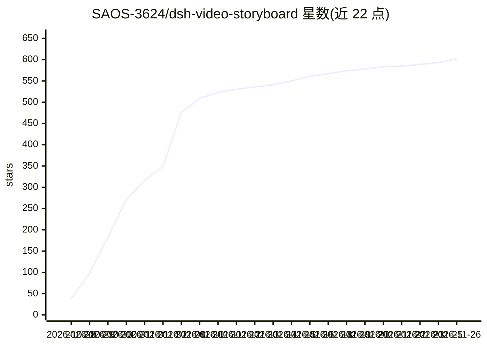

# SAOS-3624/dsh-video-storyboard

⭐ 602 · JavaScript · Apache-2.0 · 推送 2026-11-25 · [GitHub](https://github.com/SAOS-3624/dsh-video-storyboard) · [官网](https://github.com/SAOS-3624/dsh-video-storyboard) · 个人维护 · 中文 README

**给 DSH 插件生态的视频分镜工具：把视频压成宫格图+时间码清单供模型读取**

DeepSeek Harness 的插件，提供 video_storyboard / video_zoom 等六个工具：按镜头切点把视频抽帧排成一张宫格图（一格=一个镜头，格子大小按切点密度分八档），配一份带起止时间与台词的文本清单，供多模态模型按时间定位内容。转写为可选：优先字幕轨，其次已有 SRT 文件，最后走本机 ASR 服务（默认 sherpa/paraformer）。不打包 ffmpeg/yt-dlp，需自行安装；不托管视频内容、不支持 DRM 绕过。

## 筛选速览

| 维度 | 判定 | 备注 |
|---|---|---|
| AI 角色 | `ai-native` | 本体是模型或模型工具 |
| 许可风险 | `permissive` | Apache-2.0 |
| 部署形态 | `desktop` | 安装包/桌面程序 |
| 模型依赖 | — | README 未给出锁定关系 |
| 硬件要求 | — | 无带数字的原话,不猜 |
| 安装摩擦 | `medium` | 含编译或系统依赖之一 |
| 成熟度 | — | 结构信号不足 |

## 能力要点

- 一帧=一个镜头的变密度宫格排布，8 档格子大小按切点密度计算
- 宫格图+时间码台词清单打包为少量 token（默认一张约 222-233 token）
- 六档 strategy 预设与 tierMap 精确覆盖，支持 dryRun 预估张数
- 本地 ASR 后端可选 sherpa 或 funasr，支持 SRT/JSON 直喂跳过转写

## 适用场景

- 让 agent 回答'第几分钟发生了什么'这类视频时间定位问题
- 看长视频前先用一张宫格图概览镜头节奏再局部放大
- 给无字幕轨的 PV/口播视频生成带台词的分镜清单

## 场景标签

`语音识别` `图像视频处理` · 领域:感知与多模态

## 证据(README 行号)

> L37: 本插件走第三条：**把画面压成一张宫格图**（默认一张 ≈222 token，跟里面几帧无关），旁边配一份**按时间对齐的文本清单**（每格起止时间 + 这一格里的台词 + 切了几刀）。
> L49: |`video_storyboard`|出宫格图 + 文本清单|主体功能|
> L165: dsh plugin --profile web add dsh-video-storyboard       # 装插件，然后重启 DSH

## 星数曲线

2026-10-28 38 → 2026-11-26 602（+564）

---
*卡片 v1 · prompt 1.4 · 生成 2026-11-25 · 置信度 mid · 依据 README sha `e892eabb1745` · [字段定义](../../DATASET.md)*
