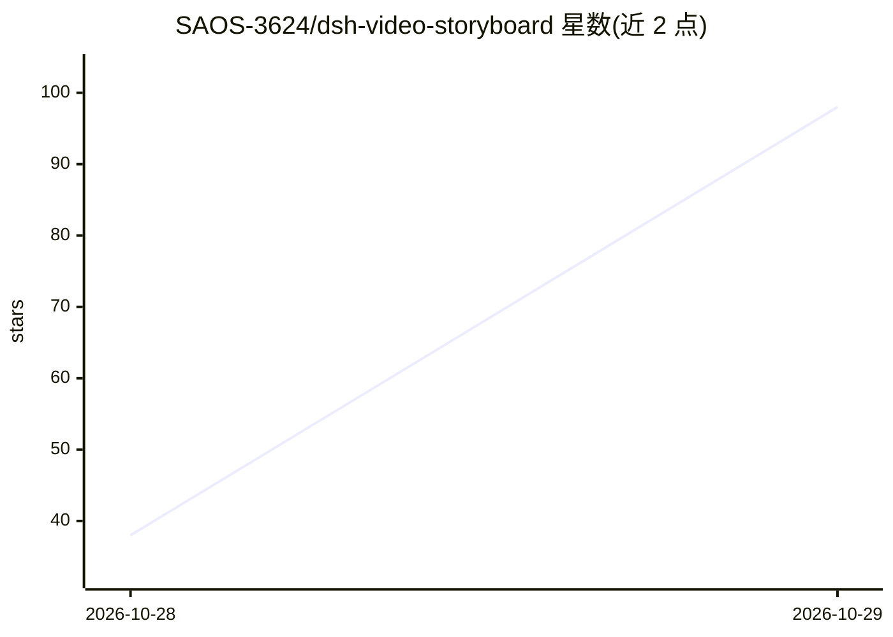

# SAOS-3624/dsh-video-storyboard

⭐ 98 · JavaScript · MIT · 推送 2026-10-28 · [GitHub](https://github.com/SAOS-3624/dsh-video-storyboard) · [官网](https://github.com/SAOS-3624/dsh-video-storyboard) · 个人维护 · 中文 README

**DeepSeek Harness 插件：把视频压成一张可寻址分镜故事板图供文本 agent 阅读**

面向 DeepSeek Harness（DSH）的插件，提供 video_storyboard 与 video_zoom 两个工具：将视频转成 9-16 格编号故事板单图（384 token），含时间戳、转录文本与音频包络，供纯文本模型按格引用与放大细读。机制包括 HSV 场景切变检测、密度驱动的格布局、拉普拉斯方差选帧、EBU R128 响度、OpenAI 兼容 ASR 分块对齐；支持 http(s) 链接（yt-dlp）、扫描缓存与 textOnly 分页。依赖 Node≥20 与 ffmpeg/ffprobe，ASR 走 OpenAI 兼容接口；v0.1 状态，社区项目非 DeepSeek 官方。

## 筛选速览

| 维度 | 判定 | 备注 |
|---|---|---|
| AI 角色 | `ai-ecosystem` | LLM/agent 周边工具 |
| 许可风险 | `permissive` | MIT |
| 部署形态 | `None` |  |
| 模型依赖 | — | README 未给出锁定关系 |
| 硬件要求 | — | 无带数字的原话,不猜 |
| 安装摩擦 | `medium` | 含编译或系统依赖之一 |
| 成熟度 | `idea` | |

## 能力要点

- 5 分钟视频压成一张 384 token 的编号故事板图（对比逐帧 3,072-6,144 token）
- HSV 场景切变检测（fixture 上 9/9 切点、0 误报，47 倍实时）
- video_zoom 回到原流逐帧放大 1080p，扫描结果缓存（二次调用 3.6 s）
- textOnly + cellRange 分页读取文本索引，CLI 批处理整片

## 适用场景

- 让纯文本 LLM agent 以低 token 成本浏览与引用视频内容
- 长片分两阶段阅读：概览图定位可疑片段后局部展开
- 对 Bilibili 等链接直接生成带转录与音频包络的故事板

## 场景标签

`多模态` · 领域:感知与多模态

## 证据(README 行号)

> L5: **A scene-aware storyboard for text-only agents.** Feed a video in, get one addressable grid out: numbered cells, a 
> L9: > Community project. Not affiliated with DeepSeek.
> L187: |`src/index.js` — registers `video_storyboard` + `video_zoom`|✅ implemented, **host contract verified**|

## 星数曲线

2026-10-28 38 → 2026-10-29 98（+60）

---
*卡片 v1 · prompt 1.4 · 生成 2026-10-28 · 置信度 high · 依据 README sha `ba881a6e66ac` · [字段定义](../../DATASET.md)*
