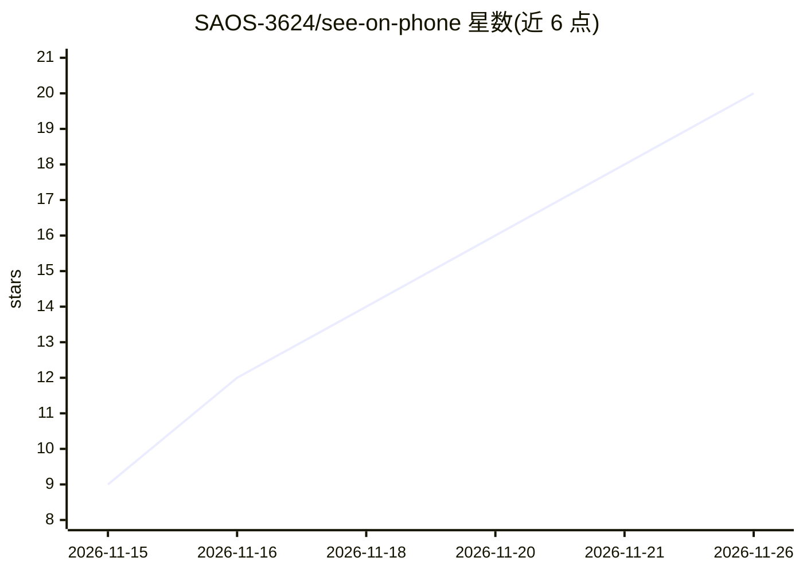

# SAOS-3624/see-on-phone

⭐ 20 · Java · Apache-2.0 · 推送 2026-11-23 · [GitHub](https://github.com/SAOS-3624/see-on-phone) · 个人维护 · 中文 README

**安卓 AI 聊天 App：对话中用手机摄像头看世界**

由两部分组成：一个自包含的 Android 聊天 App（ Releases 下 APK 安装），可在手机上与模型对话，通过 look 工具取摄像头帧、按镜头切点挑帧并拼成 471×628 宫格（约 4~7 KB / 197 token）发给用户自填的 OpenAI 兼容 API；另含语音输入、系统 TTS、跨会话记忆、文件写入工具。配套 npm 全局安装的 Node 插件 dsh-see-on-phone 让桌面 agent 经手机内置 HTTP 服务借摄像头取图，并支持手机与 DSH 双向搬运会话。README 明示导盲只是一个可选模式，且声明其不是辅具。

## 筛选速览

| 维度 | 判定 | 备注 |
|---|---|---|
| AI 角色 | `ai-native` | 本体是模型或模型工具 |
| 许可风险 | `permissive` | Apache-2.0 |
| 部署形态 | `library` | 以包/库形式分发 |
| 模型依赖 | — | README 未给出锁定关系 |
| 硬件要求 | — | 无带数字的原话,不猜 |
| 安装摩擦 | `medium` | 含编译或系统依赖之一 |
| 成熟度 | — | 结构信号不足 |

## 能力要点

- look 工具：切点检测 + 行 DP 装箱生成信息分配过的宫格图
- 端上拼帧后仅发送 4~7 KB JPEG，无中转服务器
- 会话与记忆手机⇄桌面双向增量导出导入
- App 无 Gradle/Android Studio 自编译路径（JDK 17 + android.jar）

## 适用场景

- 在手机上和模型聊天并让它描述眼前场景
- 让桌面 agent 借手机摄像头拍一张图
- 把手机上的 AI 会话搬到电脑 DSH 继续
- 视觉障碍用户的可选导盲模式（README 同时声明其不是辅具）

## 场景标签

`聊天机器人` `多模态` · 领域:对话与助手

## 证据(README 行号)

> L23: **鱼眼是一个能自己看东西的 AI 聊天 App。** 你打字或说话，模型需要知道"眼前有什么"时，
> L48: |手机上有个能聊天、能看东西的 AI|`see-on-phone-<ver>.apk`|一个 OpenAI 兼容的 API Key|
> L132: 模型调用 `see_phone` → 插件 HTTP 打手机 `/look` → 手机自己采、自己挑、自己拼 → **一张 JPEG** 回来。

## 星数曲线

2026-11-15 9 → 2026-11-26 20（+11）

---
*卡片 v1 · prompt 1.4 · 生成 2026-11-18 · 置信度 high · 依据 README sha `f0e15a23dedf` · [字段定义](../../DATASET.md)*
