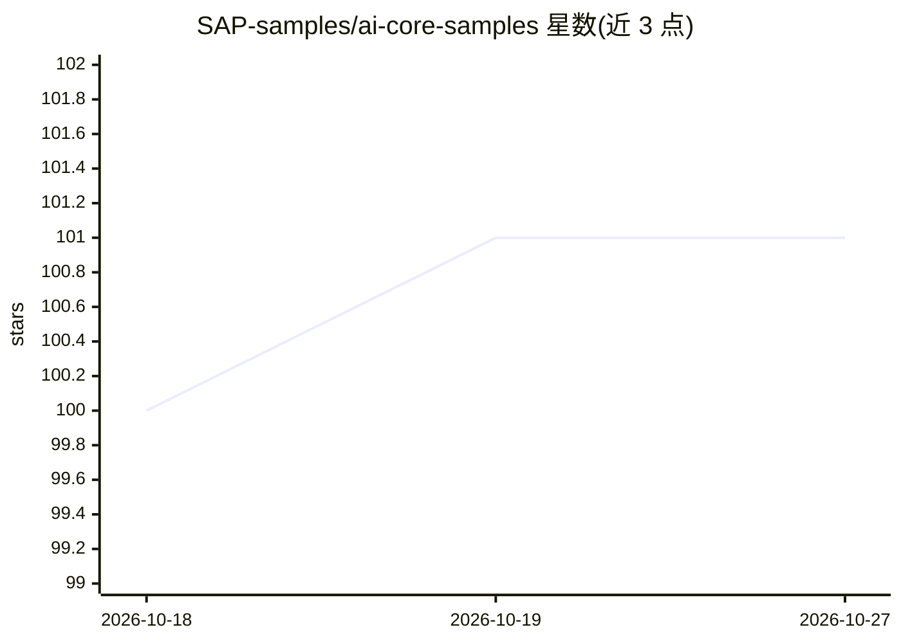

# SAP-samples/ai-core-samples

⭐ 101 · Jupyter Notebook · Apache-2.0 · 推送 2026-04-30 · [GitHub](https://github.com/SAP-samples/ai-core-samples) · 组织维护

**SAP AI Core 官方示例：notebook 与工作流模板集合**

SAP 维护的示例仓库，收录 Jupyter notebook 与工作流模板（yaml 文件），演示如何使用 SAP AI Core SDK 将业务 ML 用例产品化部署到 SAP AI Core。使用前需满足前置条件：阅读 SAP 官方教程、开通 SAP AI Core 实例（含 free-tier）、具备 GitHub 读写账号、可访问 AWS 等对象存储及 Docker 镜像仓库。内容按教程分 6 部分组织，明示仅供学习启用、不可用于生产。

## 筛选速览

| 维度 | 判定 | 备注 |
|---|---|---|
| AI 角色 | `ai-knowledge` | 知识聚合/清单类 |
| 许可风险 | `permissive` | Apache-2.0 |
| 部署形态 | `None` |  |
| 模型依赖 | — | README 未给出锁定关系 |
| 硬件要求 | — | 无带数字的原话,不猜 |
| 安装摩擦 | `low` | 无编译、无系统依赖或容器化 |
| 成熟度 | — | 结构信号不足 |

## 能力要点

- 示例 notebook 与 yaml 工作流模板，演示 ML 用例产品化到 SAP AI Core
- 教程分 6 部分，每部分有独立子目录存放 notebook 与模板
- 声明仅供 enablement，不用于生产环境

## 适用场景

- 上手 SAP AI Core 的 SDK 调用与工作流编排
- 学习如何将业务 ML 用例产品化到 SAP AI Core
- 参考模板结构搭建自己的 ML 项目流程

## 场景标签

`教程课程` · 领域:学习与行业

## 证据(README 行号)

> L4: This repository contains sample notebooks and workflow templates that can enable the user to have a quick hands-on w
> L8: The sample notebooks and the workflow templates demonstrate as to how to productise a simple Business ML use case to

## 星数曲线

2026-10-18 100 → 2026-10-27 101（+1）

---
*卡片 v1 · prompt 1.4 · 生成 2026-10-23 · 置信度 high · 依据 README sha `dd39f94ecf75` · [字段定义](../../DATASET.md)*
