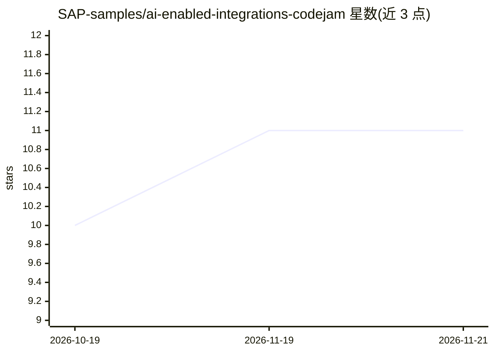

# SAP-samples/ai-enabled-integrations-codejam

⭐ 11 · Python · Apache-2.0 · 推送 2026-11-11 · [GitHub](https://github.com/SAP-samples/ai-enabled-integrations-codejam) · 组织维护

**SAP 集成场景 AI 能力实操 CodeJam 教程**

SAP 官方 CodeJam 工作坊材料，围绕 SAP Integration Suite 的 AI 功能展开：从网站表单接收客户请求事件，在 SAP Cloud Integration 中借助 SAP AI Core 托管的 LLM 处理并抽取信息，再通过 API Management 的 MCP Gateway 将现有 API 暴露为 MCP server 并配置为 LLM 工具。材料由一系列递进式练习（共 8 个）组成，含 Marp 幻灯片、troubleshooting 页面，可经 Docsify 在本地渲染为网站。前提是拥有配置好 SAP AI Core 的 Integration Suite 租户。

## 筛选速览

| 维度 | 判定 | 备注 |
|---|---|---|
| AI 角色 | `ai-knowledge` | 知识聚合/清单类 |
| 许可风险 | `permissive` | Apache-2.0 |
| 部署形态 | `library` | 以包/库形式分发 |
| 模型依赖 | — | README 未给出锁定关系 |
| 硬件要求 | — | 无带数字的原话,不猜 |
| 安装摩擦 | `low` | 无编译、无系统依赖或容器化 |
| 成熟度 | — | 结构信号不足 |

## 能力要点

- 8 个递进式练习：从 Prompt Template、iFlow 生成到 MCP server 创建与 LLM 工具配置
- 使用 SAP AI Core 托管的 LLM 处理客户请求事件并抽取关键信息
- 覆盖 API Management 中 MCP Gateway 的使用与自有 API 转 MCP server
- Docsify 渲染本地网站，含 Marp 幻灯片导出

## 适用场景

- 参加或自学 SAP 集成开发场景中的 AI 能力实操
- 了解如何在集成流中调用 LLM 与 Prompt Template
- 学习把现有 API 通过 MCP Gateway 暴露为 LLM 可调用的工具

## 场景标签

`教程课程` · 领域:学习与行业

## 证据(README 行号)

> L7: Welcome to the AI-enabled Integrations CodeJam. In this SAP CodeJam, we will look at SAP Integration Suite and the d
> L35: ## Exercises
> L44: - Exercises:

## 星数曲线

2026-10-19 10 → 2026-11-21 11（+1）

---
*卡片 v1 · prompt 1.4 · 生成 2026-11-19 · 置信度 high · 依据 README sha `fbc539efb3d4` · [字段定义](../../DATASET.md)*
