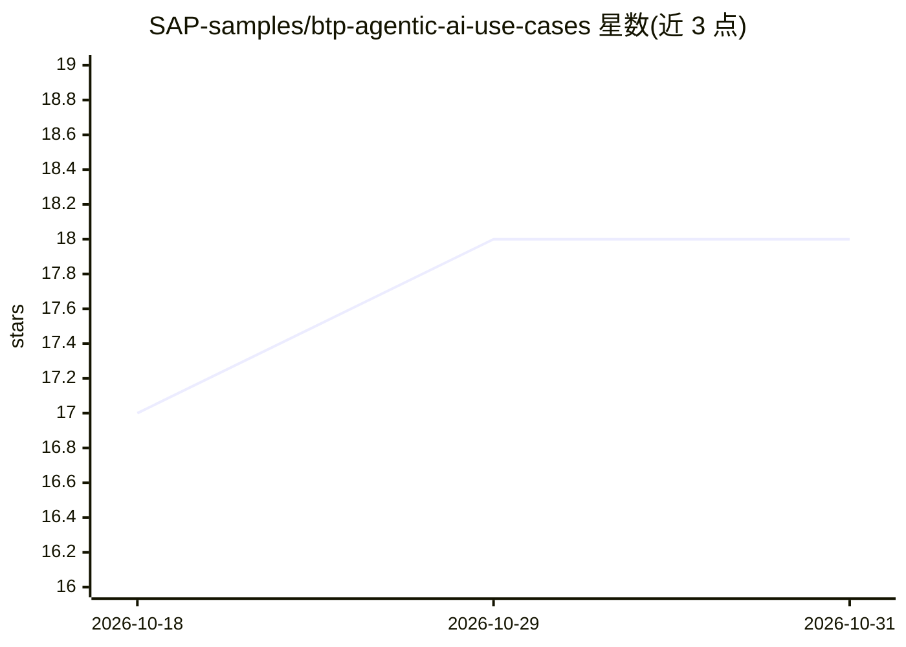

# SAP-samples/btp-agentic-ai-use-cases

⭐ 18 · Python · Apache-2.0 · 推送 2026-10-28 · [GitHub](https://github.com/SAP-samples/btp-agentic-ai-use-cases) · 组织维护

**SAP BTP 定制行业 AI Agent 示例代码集（网络研讨会系列配套）**

SAP 官方 samples 组织维护的示例仓库：收录 Reimagine 网络研讨会系列中展示的定制行业 AI Agent 项目，每个编号文件夹对应一场分享的完整可运行代码，聚焦 SAP BTP 上的具体用例。实现途径覆盖 Joule Studio 无代码/低代码 Agent Builder、Joule Studio Code Editor 及 SAP Cloud SDK for AI；包含升级助理（Escalation Assistant）示例，以及通过 A2A 协议、Async API 与 A2A Client Service 将 Joule 与代码型 deep research agent 集成的示例。各项目开发需遵循对应文件夹内 README 说明。

## 筛选速览

| 维度 | 判定 | 备注 |
|---|---|---|
| AI 角色 | `ai-knowledge` | 知识聚合/清单类 |
| 许可风险 | `permissive` | Apache-2.0 |
| 部署形态 | `None` |  |
| 模型依赖 | — | README 未给出锁定关系 |
| 硬件要求 | — | 无带数字的原话,不猜 |
| 安装摩擦 | `low` | 无编译、无系统依赖或容器化 |
| 成熟度 | — | 结构信号不足 |

## 能力要点

- 每个编号文件夹为独立完整可运行项目
- 覆盖 Joule Studio 无代码/低代码与 Pro-Code 多种实现途径
- 包含 A2A 协议与 Async API 的 Joule 集成示例

## 适用场景

- 参考 SAP BTP 上的行业 AI Agent 构建方式
- 学习 Joule Studio Agent Builder 与 A2A 集成
- 跟随网络研讨会系列动手复现用例

## 场景标签

`教程课程` · 领域:学习与行业

## 证据(README 行号)

> L7: This GitHub repository contains a collection of Custom Industry AI Agent samples presented during the webinar series
> L8: Each numbered folder in the repository corresponds to the code presented in an individual session.

## 星数曲线

2026-10-18 17 → 2026-10-31 18（+1）

---
*卡片 v1 · prompt 1.4 · 生成 2026-10-29 · 置信度 high · 依据 README sha `072d4af4687f` · [字段定义](../../DATASET.md)*
