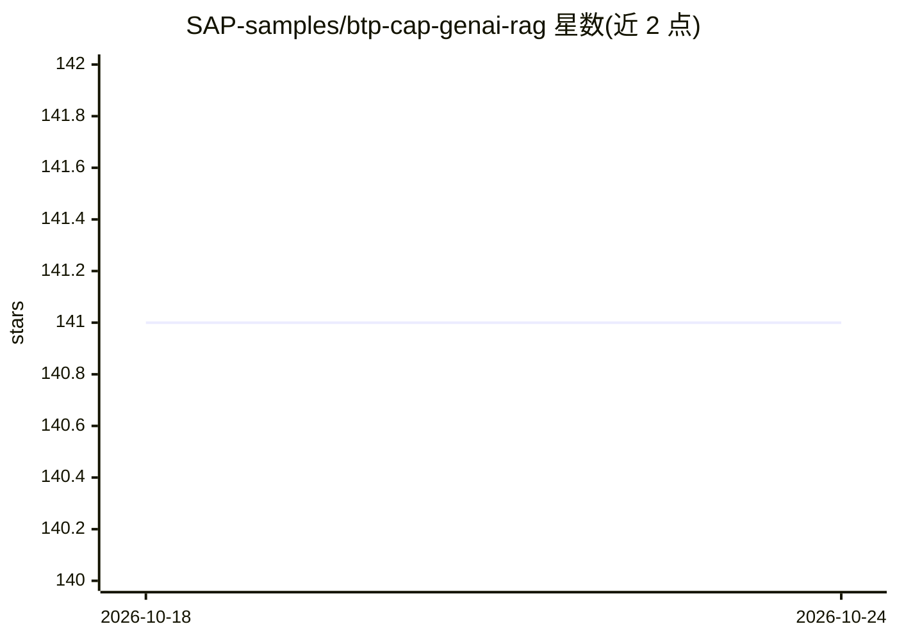

# SAP-samples/btp-cap-genai-rag

⭐ 141 · TypeScript · Apache-2.0 · 推送 2026-08-05 · [GitHub](https://github.com/SAP-samples/btp-cap-genai-rag) · [官网](https://discovery-center.cloud.sap/refArchDetail/ref-arch-open-ai) · 组织维护

**SAP BTP 上 CAP+GenAI+RAG 的示例应用：邮件洞察客服场景**

SAP 官方样例仓库，演示在 SAP BTP 上用 CAP 框架开发 GenAI 应用：通过 SAP AI Core 的 Generative AI Hub 接入基础模型与 LLM，结合 LangChain 实现输出解析与 RAG，向量存储用 SAP HANA Cloud Vector Engine。业务场景为旅行社客服：用 LLM 分析来访邮件的分类、情感与紧急度，提取关键事实与自定义字段，基于邮件 embedding 检索相似历史邮件，并生成候选回复；可连接 SAP Concur 等系统，支持单租户与多租户 SaaS 部署，提供分步部署教程。

## 筛选速览

| 维度 | 判定 | 备注 |
|---|---|---|
| AI 角色 | `ai-ecosystem` | LLM/agent 周边工具 |
| 许可风险 | `permissive` | Apache-2.0 |
| 部署形态 | `library` | 以包/库形式分发 |
| 模型依赖 | — | README 未给出锁定关系 |
| 硬件要求 | — | 无带数字的原话,不猜 |
| 安装摩擦 | `low` | 无编译、无系统依赖或容器化 |
| 成熟度 | — | 结构信号不足 |

## 能力要点

- LLM 邮件分析：分类、情感、紧急度、关键事实提取
- 基于邮件 embedding 检索相似历史邮件
- RAG 通过 SAP HANA Cloud Vector Engine 与 LangChain 实现
- 提供单租户与多租户 SaaS 版本及分步部署教程

## 适用场景

- 在 SAP BTP 上参考 Reference Architecture 构建 GenAI 应用
- 为客户支持场景搭建邮件自动分析与回复生成
- 学习 CAP 中集成 LangChain 与向量引擎的做法

## 场景标签

`RAG` `教程课程` · 领域:知识与检索

## 证据(README 行号)

> L5: Welcome to our dedicated GitHub repository, designed to provide valuable support to developers, partners and custome
> L17: The provided code sample presents an application crafted by a potential SAP partner or customer, tailored for SAP B

## 星数曲线

2026-10-18 141 → 2026-10-24 141（+0）

---
*卡片 v1 · prompt 1.4 · 生成 2026-10-22 · 置信度 high · 依据 README sha `ea178c65ac38` · [字段定义](../../DATASET.md)*
