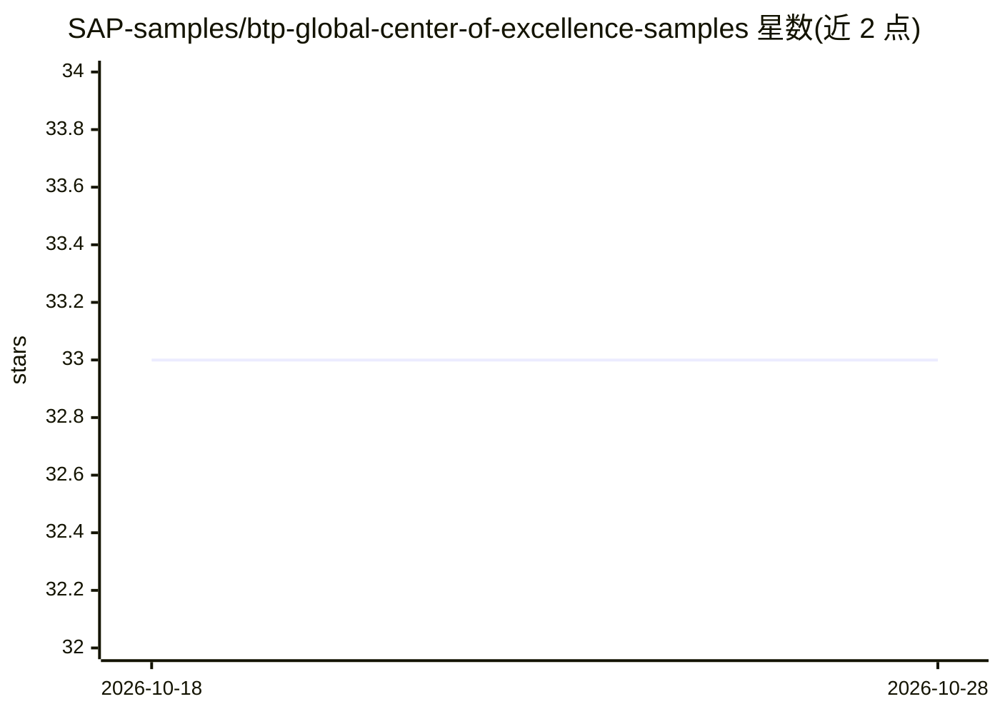

# SAP-samples/btp-global-center-of-excellence-samples

⭐ 33 · Jupyter Notebook · Apache-2.0 · 推送 2026-06-02 · [GitHub](https://github.com/SAP-samples/btp-global-center-of-excellence-samples) · 组织维护

**SAP BTP 全球卓越中心配套博客的示例代码集**

SAP 全球卓越中心（BTP 方向）维护的示例代码仓库：按博客或博客系列分文件夹收录配套文件，内容对应 blogs.sap.com 上发布的教程，主题标签涉及机器学习、Python、SAP BTP、CAP、HANA Cloud 等。无统一安装步骤，各子文件夹内单独说明所需基础设施、软件与使用方法。SAP 声明内容不提供官方支持，问题通过 issue 或 SAP Community 提出，采用 Apache 2.0 许可。

## 筛选速览

| 维度 | 判定 | 备注 |
|---|---|---|
| AI 角色 | `ai-knowledge` | 知识聚合/清单类 |
| 许可风险 | `permissive` | Apache-2.0 |
| 部署形态 | `None` |  |
| 模型依赖 | — | README 未给出锁定关系 |
| 硬件要求 | — | 无带数字的原话,不猜 |
| 安装摩擦 | `low` | 无编译、无系统依赖或容器化 |
| 成熟度 | — | 结构信号不足 |

## 能力要点

- 按博客系列分文件夹组织的示例代码
- 覆盖 BTP、CAP、HANA Cloud 与机器学习等主题
- 各子文件夹单独说明运行要求与用法

## 适用场景

- 跟随 SAP 博客教程时获取配套代码
- 查阅 SAP BTP / CAP / HANA Cloud 的实践示例
- 参考机器学习与 SAP 平台结合的样例实现

## 场景标签

`教程课程` · 领域:学习与行业

## 证据(README 行号)

> L5: Repository from the Global Center of Excellence for BTP to provide the files that are needed to follow our blogs on 
> L9: There are no general requirements. For each sample there might be different infrastructure or software required to r

## 星数曲线

2026-10-18 33 → 2026-10-28 33（+0）

---
*卡片 v1 · prompt 1.4 · 生成 2026-10-25 · 置信度 mid · 依据 README sha `89bbc881c915` · [字段定义](../../DATASET.md)*
