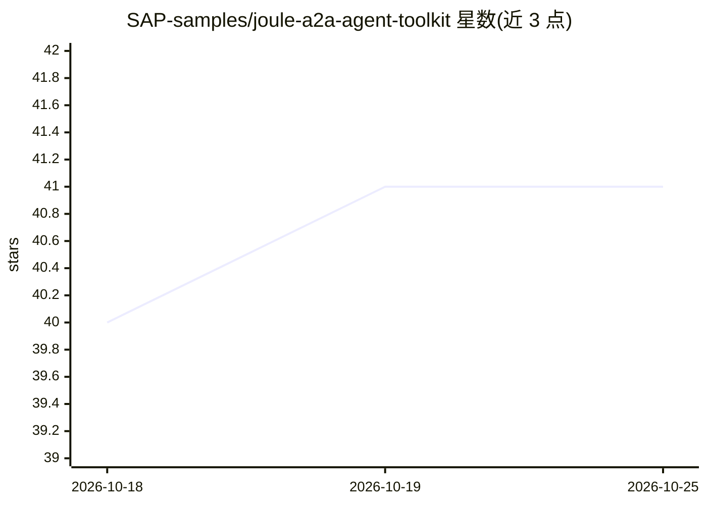

# SAP-samples/joule-a2a-agent-toolkit

⭐ 41 · Shell · Apache-2.0 · 推送 2026-04-21 · [GitHub](https://github.com/SAP-samples/joule-a2a-agent-toolkit) · 组织维护

**Claude Code 插件：脚手架生成并部署 SAP Joule A2A agent 到 BTP**

面向 SAP 生态开发者的 Claude Code 插件：以技能（按上下文自动触发）与命令两种形式，脚手架生成带 A2A 协议支持的 LangGraph agent 项目（TypeScript/Express 或 CAP，或 Python），生成 BTP/CF/Joule CLI 命令，并串起 CF push/MTA 部署、BTP destination 创建与 Joule capability 编译部署。LLM 接入为 SAP GenAI Hub（@sap-ai-sdk/langchain），协议为 A2A v0.3.0。前置要求包含 cf CLI v8、Joule CLI、Node.js 24.x、Python 3.12+、mbt 与 MTA 插件，部分为按 agent 类型可选。

## 筛选速览

| 维度 | 判定 | 备注 |
|---|---|---|
| AI 角色 | `ai-ecosystem` | LLM/agent 周边工具 |
| 许可风险 | `permissive` | Apache-2.0 |
| 部署形态 | `library` | 以包/库形式分发 |
| 模型依赖 | locked-api |  |
| 硬件要求 | — | 无带数字的原话,不猜 |
| 安装摩擦 | `low` | 无编译、无系统依赖或容器化 |
| 成熟度 | — | 结构信号不足 |

## 能力要点

- 4 个上下文触发技能覆盖 agent 脚手架与 BTP/CF/Joule CLI 命令生成
- 3 个命令完成创建 agent、创建 BTP destination、一键完整部署
- 支持 TypeScript (Express/CAP) 与 Python，A2A v0.3.0 (JSON-RPC 2.0 over HTTPS)
- LLM 层接入 SAP GenAI Hub via @sap-ai-sdk/langchain OrchestrationClient

## 适用场景

- 我想快速搭建一个可接入 SAP Joule 的 A2A agent 并部署到 BTP Cloud Foundry
- 我在 Claude Code 里用自然语言描述需求，让插件自动生成 agent 项目
- 我需要把已建好的 agent 一键部署并注册为 Joule capability

## 场景标签

`代码生成` · 领域:编码与开发

## 证据(README 行号)

> L5: Build, deploy, and connect AI agents to SAP Joule via the A2A (Agent-to-Agent) protocol on BTP Cloud Foundry — all f
> L13: |**joule-a2a-agent**|"build an agent for Joule", "create A2A agent", "deploy agent to BTP", "CAP agent"|Scaffolds a

## 星数曲线

2026-10-18 40 → 2026-10-25 41（+1）

---
*卡片 v1 · prompt 1.4 · 生成 2026-10-25 · 置信度 mid · 依据 README sha `4254cbd5a0ef` · [字段定义](../../DATASET.md)*
